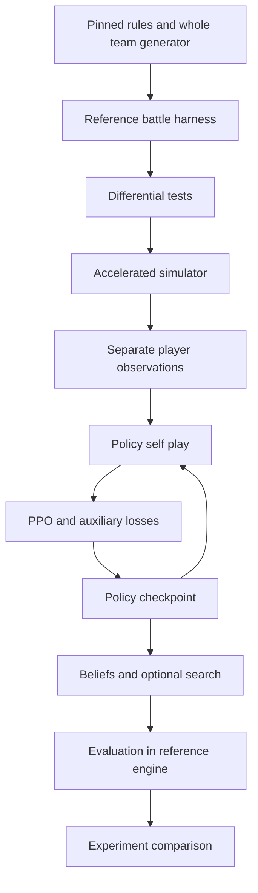

Prepared 10 October 2026 for the engineer or research team building an independent Gen 9 Random Battles agent.

**Recommendation: build a faithful environment and a strong policy first; add search after the policy works.** The project is technically approachable, but matching its strength is a research and simulator-engineering effort. The first milestone should be a reproducible local battle harness with correct information boundaries, followed by a measured decision about the accelerated engine.

The author explicitly decided on 12 September 2026 not to release Jaxcalibur’s code or model weights. The public description therefore supports an independent recreation, not an exact reproduction. Treat the original’s performance as a reported benchmark and the implementation choices below as proposals. No engine, dataset pipeline, or training run has been executed as part of this handoff. [Author’s update](https://www.smogon.com/forums/threads/jaxcalibur-a-gen-9-randbats-bot-that-reached-1-on-the-ladder.3787537/)

## What Jaxcalibur establishes

Jaxcalibur plays **Generation 9 Random Battles**, where teams are generated for the players. The author reports peak Elo 2557 and GXE 95.3, while acknowledging that a human outperformed it over the observed period. These are historical ladder results, not a transferable rating guarantee. The author also identifies PP stalling and predictable play as weaknesses and reports more than six months of intermittent development. [Project announcement and author replies](https://www.smogon.com/forums/threads/jaxcalibur-a-gen-9-randbats-bot-that-reached-1-on-the-ladder.3787537/)

The published technical specification is compact:

| Component | Reported design |
|---|---|
| Network | 8.5M parameters; bidirectional transformer; pre-RMSNorm; token-type-specific MLPs |
| Input tokens | Battlefield 1; active Pokémon 2; moves including Struggle 5; own team 6; opponents 6; events 16; matchup tokens 24 inserted halfway |
| Outputs | Switch and move/Tera logits; value; opponent item, ability, move, Tera and next-action predictions; persistent item/ability beliefs |
| Learning | Pure self-play PPO with GAE; undiscounted win/loss rewards 1/0; entropy and zero-avoidance regularization; no training search |
| Final run | Nearly 100M games; approximately one week on one H100 |
| Simulator | Custom JAX engine; batched/JIT execution; fixed computation with irrelevant results masked |
| Search | Sampled hidden worlds, stochastic trajectories, hashed statistics, ten HP bins; own keys omit opponent secrets, opponent keys include world ID |
| Opponent modeling | Search stops after surprises: unrevealed switch or move predicted below 65% |
| Inference budget | Depth 4, usually two turns; 20,480 total rollouts over 32 worlds; seconds on GPU; estimated search gain 100–150 Elo |

Its selection rule is `weight(a) = max(Q(a) − V, 0) + c_puct × P(a) / sqrt(N)`, normalized over actions. [Technical write-up](https://jaxcalibur.github.io/)

## How to understand the system

A policy maps what a player knows to a probability distribution over choices. A value function estimates the eventual result. A belief model estimates information the player cannot see. The simulator generates consequences and training experience. Search spends additional computation comparing possible futures before acting.

This is an imperfect-information, stochastic, simultaneous-action game. At an ordinary turn, each player commits before seeing the other’s choice; random outcomes then resolve. A reliable agent needs a useful representation of uncertainty and sometimes needs to randomize its own choices. A deterministic highest-scoring action can be exploitable even when its immediate evaluation looks good.

The proposed recreation has two distinct paths:



The main engineering hypothesis is that correct, cheap experience generation will matter more initially than increasing network size. Test that hypothesis using strength per GPU-hour, alongside simulator fidelity and throughput.

## Components to reuse

| Component | Use in the recreation | Boundary |
|---|---|---|
| [Pokémon Showdown](https://github.com/smogon/pokemon-showdown) | Rules, exact team generator, reference simulator and local matches | Repository reports MIT; retain a pinned commit as the correctness reference |
| [poke-env](https://github.com/hsahovic/poke-env) | Python integration, local evaluation, baseline players | MIT; an interface to Showdown, not an accelerated simulator |
| [poke-engine](https://github.com/pmariglia/poke-engine) | Rust CPU forward-model candidate and search experiments | MIT; explicitly warns that it is less complete/robust than Showdown; validate supported mechanics |
| [Foul Play](https://github.com/pmariglia/foul-play) | Strong fixed opponent and search/belief reference | GPL-3.0; distinguish using an opponent from incorporating its source |
| [pkmn/randbats](https://github.com/pkmn/randbats) | Aggregated set options and frequencies for checks/priors | MIT; marginal statistics do not reproduce the joint team distribution |
| [Metamon](https://github.com/UT-Austin-RPL/metamon) | Offline RL, replay reconstruction and pretrained-policy reference | MIT code; data/model licenses differ; documented datasets emphasize OU rather than randbats |

The accelerated-engine choice remains open. [pkmn/engine](https://github.com/pkmn/engine) currently documents older-generation scope. A [PokeJAX paper](https://arxiv.org/html/2603.12145v1) is a useful lead, but this audit did not locate a verified implementation-ready Gen9 code release. The separately found [JerJer2465/pokejax](https://github.com/JerJer2465/pokejax) targets Gen4. None should be assumed to replace the required Gen9 engine without a coverage audit.

Use existing CPU infrastructure to reduce algorithmic risk while assessing the GPU path. Do not make an accelerated engine the reference against which it certifies itself.

## Data acquisition and versioning

The mandatory training data can be generated locally. It consists of mechanics, complete legal teams, self-play trajectories, and the true hidden attributes used only as supervision. A large human replay corpus is optional.

**Generate whole teams with pinned Showdown code.** Start at [`sim/teams.ts`](https://github.com/smogon/pokemon-showdown/blob/master/sim/teams.ts), using `Teams.generate` or `Teams.getGenerator`. The Gen9 generator is [`data/random-battles/gen9/teams.ts`](https://github.com/smogon/pokemon-showdown/blob/master/data/random-battles/gen9/teams.ts), with options in [`sets.json`](https://github.com/smogon/pokemon-showdown/blob/master/data/random-battles/gen9/sets.json). Preserve order, levels, EVs/IVs, moves, item, ability and Tera type. Items and compatibility rules are computed in code; the JSON alone is insufficient. Current code starts EVs at 85 per stat and applies adjustments, illustrating why tutorial constants are a poor data source.

Pre-generate a proposed initial corpus of 100,000 teams to inspect mechanics coverage and frequency, then scale or stream generation. Keep complete teams intact. Sampling each Pokémon’s attributes independently destroys correlations and can generate impossible combinations. A finite team pool also risks memorization; reserve unseen seeds and periodically replenish training teams.

**Freeze the full format.** [`config/formats.ts`](https://github.com/smogon/pokemon-showdown/blob/master/config/formats.ts) and [`data/rulesets.ts`](https://github.com/smogon/pokemon-showdown/blob/master/data/rulesets.ts) matter as much as move tables: random battles include sleep restrictions, percentage HP reporting, and Illusion-specific rules. Generic Gen9 or OU is a different environment. Resolve inherited rules and record any server configuration affecting team generation.

**Record randomness precisely.** Current [`sim/prng.ts`](https://github.com/smogon/pokemon-showdown/blob/master/sim/prng.ts) supports string seeds and defaults to a sodium/ChaCha20 source; older simulator documentation describes numeric arrays. Save the actual revision and seed representation. A shared seed across different engines does not imply shared random outcomes.

Create these artifacts before scaling:

| Artifact | Required fields |
|---|---|
| `sources.lock.json` | Repository commits, format/rules hash, retrieval date, dependency versions, license metadata, configuration |
| `dex/` | Deterministic ID maps, numeric metadata, source hashes, explicit handler IDs for executable mechanics |
| `teams/` | Exact ordered teams, generator seed/revision, team hash, train/development/test split |
| `mechanics.csv` | Reachable effect, implementation status, source path, frequency, unit/interaction tests, known approximation |
| `rollouts/` | Episode/request IDs, player, phase, observation, chosen action, mask, old log-probability/value, rewards, terminal/truncation reason, policy revision |
| `privileged_targets/` | True hidden sets and simulator states, accessible to target generation but excluded from actor inputs |
| `eval_manifest.json` | Held-out teams/seeds, opponent checkpoints, side assignments, budgets, hardware, exclusions and uncertainty method |

Extract metadata through the pinned Dex API. Move files also contain executable callbacks; JSON export cannot reproduce their semantics. Coverage must include effects reachable through copied/called moves and transformations, beyond initial movepools. [Showdown move implementations](https://github.com/smogon/pokemon-showdown/blob/master/data/moves.ts)

### Optional replay data and pretrained models

| Resource | Verified availability | Recommended role |
|---|---|---|
| [Jaxcalibur replay archive](https://jaxcalibur.github.io/replays/) | Index lists 953 public battles out of 2,188 played | Qualitative analysis and held-out decision cases |
| [HolidayOugi Showdown replays](https://huggingface.co/datasets/HolidayOugi/pokemon-showdown-replays) | Card dated 5 October 2026 lists 2,012,698 Gen9 Random Battle replays; some records invalid; no license declaration located | Candidate randbats corpus after rights, quality and version checks |
| [Metamon parsed replays](https://huggingface.co/datasets/jakegrigsby/metamon-parsed-replays) | Listed archives cover Gen1–4 OU and Gen9 OU; CC-BY-NC-4.0 | Reconstruction/data-loader reference and optional transfer research |
| [Metamon checkpoints](https://huggingface.co/jakegrigsby/metamon) | Public checkpoints; model card reports Apache-2.0 | Candidate transfer baseline; randbats compatibility must be tested |
| [PokéAgent resources](https://pokeagent.github.io/track1.html) | Baselines and datasets for its specified constructed-team formats | Evaluation and research reference; not a randbats benchmark |

In the [88-turn annotated Jaxcalibur example](https://jaxcalibur.github.io/replays/battle-gen9randombattle-2692834507.html), the page exposes candidate preferences, win estimates and predicted replies, including some decisions without search. These are useful diagnostic traces. Selected, rounded preferences are not automatically a complete policy distribution, and estimates are not ground-truth action values. The archive is not the original self-play dataset.

Public replays show a spectator’s view. They omit information the acting player had and may omit the selected action when a move never executes. Reconstructing trajectories requires missing-data masks, confidence tags and a consistent information cutoff. Metamon explicitly describes this reconstruction gap. [Metamon replay documentation](https://github.com/UT-Austin-RPL/metamon#serverreplay-sim2sim-gap)

For an optional warm start, first inspect a small randbats sample, align each replay window to historical generator/rules revisions or document the residual mismatch, deduplicate by battle ID, and keep both player perspectives in one split. Upload date may differ from battle date; retain both when available. Infer missing own-team information only as uncertain reconstruction; never backfill opponent secrets into earlier inputs. Train a short imitation/auxiliary baseline, then compare PPO fine-tuning against pure self-play at matched total compute. Discount or mask unreliable action labels. Reject the warm start if it adds reconstruction effort without improving held-out performance. No available checkpoint should be described as a ready Jaxcalibur substitute.

## The simulator and information contract

Separate four objects:

1. **FullState:** true teams, precise HP, random state, event queue and pending actions; engine only.
2. **PlayerView:** that player’s own information and correctly timed observable events/requests.
3. **BeliefState:** predictions about unknown facts, with uncertainty and persistent memory.
4. **TrainingTargets:** privileged labels for auxiliary supervision, never direct actor features.

Start the reference harness from [`BattleStream`](https://github.com/smogon/pokemon-showdown/blob/master/sim/SIMULATOR.md) and [`getPlayerStreams`](https://github.com/smogon/pokemon-showdown/blob/master/sim/battle-stream.ts). The separate player and omniscient streams help enforce this contract. Use a versioned action codec; do not assume poke-env’s generic action IDs match a compact custom policy head.

A decision boundary is not always a full turn. Model ordinary simultaneous choices, replacements after fainting, pivot interruptions with a pending opponent move, automatic resolution, and termination explicitly. For simultaneous decisions, construct both observations before sampling either action. A side that has no choice contributes no policy-loss sample. Legality must match what the player can know and submit; omniscient trapping or move restrictions must not leak through a mask.

Also model rejected submissions and re-requests. Showdown can reject a switch when trapping becomes confirmed and update the request. Preserve the attempted action, zero immediate reward, updated observation/mask and ensuing choice as explicit trajectory events; do not silently replace the sampled action while retaining its old log probability. [Choice handling](https://github.com/smogon/pokemon-showdown/blob/master/sim/side.ts)

For a JAX implementation, use fixed-shape arrays, explicit phases, pure transitions and separate random streams. Keep integer battle arithmetic exact. Batch the hot path and profile host/device transfers, resets, damage-feature generation, model inference and updates separately. Compilation and asynchronous execution can distort timings; warm up and synchronize measurements. [JAX compilation](https://docs.jax.dev/en/latest/jit-compilation.html), [benchmarking guidance](https://docs.jax.dev/en/latest/benchmarking.html)

The acceptance suite should include:

- Exact damage rounding, speed/priority, status, hazards, items, abilities, Tera, PP, recovery, restrictions, fainting, pivot/replacement order, Illusion/transformation, and terminal rules.
- Deterministic fixtures with controlled random outcomes, plus probability-distribution tests for stochastic effects. Align semantic random events or the reference PRNG call schedule; do not compare arbitrary matching seeds.
- Whole-battle differential tests against Showdown at each decision boundary, with minimized failing traces saved as regressions. Test eager, JIT and batched execution.
- Hidden-information invariance: changing an inaccessible fact while preserving a player’s legitimate history must leave its observation, mask and actor outputs unchanged.
- Transfer evaluation: a policy trained in the accelerated engine must retain performance under the same matchup protocol in Showdown.

Do not silently simplify unsupported mechanics. Mark a restricted environment as such until full coverage of the frozen format passes. Random fuzzing alone cannot certify the rare interactions an optimizing policy might exploit.

## Proposed model and training recipe

Use JAX with a maintained neural-network library such as Flax or Equinox and Optax, selected after a small implementation/profiling spike. Establish a simple encoder baseline, then test specialist MLPs, explicit damage features and later pairwise features. Candidate sizes are widths 192/256 and 4/6 layers; measure actual parameter counts. These are experimental choices, not recovered settings.

The actor consumes PlayerView plus its own predicted beliefs. Begin with event-derived memory that can be reconstructed from saved observations. For learned recurrent memory, save rollout-start state, train contiguous sequences with burn-in, and explicitly manage stale hidden states after parameter updates; this is an additional algorithmic choice. The default critic uses the same information. Privileged hidden attributes may supervise prediction heads, but true labels must never be substituted into policy-facing damage calculations, memory or features. Test a privileged critic only as a separately specified experiment. Distinguish unknown items from no item, and update known facts correctly after removal, exchange, suppression or transformation.

PPO repeatedly collects actions under a frozen behavior policy and makes bounded updates to increase the probability of actions with better-than-predicted outcomes. GAE estimates advantages from rewards and value predictions, trading variance against bias. [PPO](https://arxiv.org/abs/1707.06347), [GAE](https://arxiv.org/abs/1506.02438)

Use **per-player decision trajectories**. The next state for an advantage calculation is that same player’s next valid observation, after intervening events. Attach terminal outcomes to each player’s last pending transition even if it receives no further request. Keep games running across rollout buffers; a buffer ending is not a loss. If a side is waiting at a cut, retain its pending transition until its next actual request or termination, and bootstrap using a frozen behavior-policy value with the correct memory. Real terminal transitions have zero bootstrap, while nonterminal collection cuts bootstrap. Define safety caps separately from actual rule-defined draws; Showdown’s built-in turn-limit tie is a terminal outcome. [Termination implementation](https://github.com/smogon/pokemon-showdown/blob/master/sim/battle.ts) Do not negate values after every engine microstep.

A proposed starting objective to minimize is:

```text
L = - PPO_clipped
    + cV * value_regression
    - cH * entropy(policy)
    + cU * KL(uniform_legal || policy)
    + cB * hidden_attribute_prediction
    + cO * opponent_action_prediction

delta[t] = reward[t] + gamma * (1 - terminal[t]) * V(next_same_player)
           - V(current_player_observation)
```

The direction of the uniform KL matters: `KL(U || policy)` penalizes extremely small legal-action probabilities. `KL(policy || U)` is an entropy equivalent and does not have the same barrier behavior. Use masked log-softmax and handle singleton/inactive choices. This is a proposed realization, not a recovered original formula.

Train values against detached lambda-return targets; treat win-probability calibration as an evaluation metric. Opponent-action labels must correspond to the relevant request before resolution, including choices whose moves later fail. Do not simply use the next visible move as the label. Use categorical or multilabel objectives appropriate to each attribute, with explicit missing/ambiguous-label masks.

Candidate smoke configuration:

```yaml
format: gen9randombattle
rules_revision: REQUIRED_PIN
training_search: false
gamma: 1.0
draw_reward: 0.5             # proposed convention
gae_lambda: 0.95            # compare 0.99 and 1.0
ppo_clip: 0.2
learning_rate: 0.0003
update_epochs: 2
gradient_norm_cap: 1.0
parallel_battles: 256       # profile 256 through 1024
rollout_boundaries: 128     # requires phase-aware per-player assembly
```

This is a starting experiment specification, not executable project configuration. Loss weights, minibatch size, optimizer schedule and architecture require tuning. Normalize each auxiliary loss deliberately so large heads do not dominate. Start with shared-policy self-play; when adding frozen opponents, train only on the current learner’s on-policy actions. Preserve checkpoint/opponent IDs in every sample.

Monitor policy KL, clip fraction, entropy by legal-action count, value calibration, gradients, invalid actions, episode lengths, truncations, belief accuracy and end-to-end throughput. Current-self-play win rate near 50% says little about absolute progress. Stop large runs on NaNs, leakage, unexplained mechanics divergences, or reference-engine regressions.

## Beliefs and search

A world is one coherent hypothesis about unknown teams/sets. A finite pool of unconditional teams quickly loses support as several species and sets are revealed. Use that pool to validate a conditional-completion sampler: fix revealed constraints, sample compatible joint set templates, and complete the remaining team using the pinned generator’s composition rules. Account for uncertain ordering and initial versus current item state. This modified generator is an approximate proposal, not the original generator’s exact conditional distribution; do not call weights exact importance corrections without evaluable proposal probabilities. Validate on synthetic partial reveals of fully generated teams, measuring calibration, impossible-world rate and support for zero through six revealed species. Define an explicit fallback when evidence leaves no valid world. Particle filtering or a learned conditional proposal can follow once this baseline is tested.

Keep a sampled hidden set fixed within a simulated trajectory unless an actual event changes it. Do not give a Pokémon a different unrevealed move or item each time a node is revisited. Include likelihood information from damage, speed order and revealed effects only when modeled correctly. Test correlated set examples explicitly.

Begin search with a frozen policy and one-step action evaluation against an observation-only opponent policy. Then add deeper joint-action nodes. At a simultaneous node, select both actions before resolution. Aggregate root action values over possible worlds; optimizing a separate root decision in each hidden world creates an unrealistically informed strategy.

Information-set keys need the acting player’s private knowledge, phase and sufficient observable history/belief memory. A public board alone can merge states with different knowledge. Conversely, raw world IDs can distinguish facts a modeled player does not know. Most subtly, **masking opponent network inputs is insufficient if search backups optimize its decisions using our actual secrets**. Keep the first opponent model fixed to its observation-only policy; stronger opponent search needs explicit beliefs about our unknown information and invariance tests across those secrets.

Treat the published positive-advantage selection heuristic as a baseline to investigate. It does not by itself establish cumulative regret minimization, CFR, or a Nash guarantee. Determinization can fuse incompatible information-dependent strategies, and simultaneous-search convergence requires assumptions beyond a plausible-looking local rule. [Information Set MCTS](https://eprints.whiterose.ac.uk/id/eprint/75048/1/CowlingPowleyWhitehouse2012.pdf), [simultaneous-move MCTS analysis](https://arxiv.org/abs/1804.09045)

Test mixed strategies on matching pennies, rock-paper-scissors and small solvable battle subgames. Compare root mean-strategy sampling with final selection-distribution sampling; make deterministic argmax a separate ablation. Sweep no search, 128/512/2,048 rollouts and larger budgets only after benefits appear. Vary worlds and rollouts per world separately. Evaluate exact HP keys before introducing abstractions near KO/recovery thresholds. Return a legal policy fallback on timeout.

## Evaluation and improvement experiments

All consequential comparisons should run in pinned Showdown against fixed versions of random play, a damage heuristic, a stronger search baseline, past checkpoints and independently trained exploiters. Freeze time budgets and sample settings. Hold out teams/seeds and a final test opponent pool from checkpoint selection. Keep repeated teams and both sides of a replay together when splitting data.

Pair team assignments and swap sides to reduce team imbalance. Treat each pair as a statistical cluster. Identical random seeds alone do not align chance after action sequences diverge. Report confidence intervals over team/seed blocks and variability across independent training runs.

For independent games near a 50% win rate, approximate 95% interval half-width is `0.98 / sqrt(n)`: about 4.9 percentage points for 400 games, 2.0 for 2,500, and 1.0 for 10,000. These are precision estimates, not power guarantees for comparing two agents. Use a predeclared minimum useful improvement and an appropriate paired analysis. Run at least three training seeds for serious pilots. Report wins/draws/losses, opponent breakdown, timeouts, latency and reference-engine failures alongside ratings.

| Priority | Proposed experiment | What would justify keeping it |
|---|---|---|
| 0 | Correct mechanics and observations | No unresolved divergences on the declared suite; transfer to Showdown |
| 1 | Durable PP/reveal memory and long-game curriculum | Better stall/endgame suite results without general regression |
| 1 | Calibrated correlated beliefs | Better held-out likelihood/calibration and battle performance |
| 1 | Set and opponent-action head ablations | Win-rate improvement at matched training compute |
| 2 | Historical opponent pool or league | More robust cross-play, fewer cycles, resistance to trained exploiters |
| 2 | Adaptive search allocation | Better strength at equal latency or equal strength at lower cost |
| 3 | Distill strong search distributions into the policy | Better policy-only results with teacher cost included |
| 3 | Larger model or richer recurrent memory | Better strength per total GPU-hour than training the smaller baseline longer |

Opponent populations and average-strategy methods are established research directions, but their benefit here remains an experiment. [NFSP](https://arxiv.org/abs/1603.01121), [policy-space response-oracle research](https://arxiv.org/abs/1711.00832)

Use approximate best-response agents as adversarial tests; their failure to exploit a model does not establish exact exploitability or equilibrium. Larger model size, more search and human pretraining are competing uses of compute, not guaranteed improvements. Expanding to doubles, team building or another generation should follow a successful single-format baseline.

## Compute and staffing assumptions

The reported final-run scale implies roughly **168 H100-hours** and **165 completed games per second**, using seven days and 100M games as approximations. This calculation does not establish our throughput or the author’s total development compute.

As a planning example, 100M games averaging 50 full turns with two player decisions per turn produce about 10B decision records. At an assumed 256 bytes per record, that is 2.56 TB before overhead. Forced choices, record size and game length change the estimate. Stream PPO buffers and retain selected traces, metrics and checkpoints instead of writing every transition permanently.

| Experimental envelope | At hypothetical $2/GPU-hour | At $4/GPU-hour | At $8/GPU-hour |
|---|---:|---:|---:|
| 300 GPU-hours | $600 | $1,200 | $2,400 |
| 1,000 GPU-hours | $2,000 | $4,000 | $8,000 |

These are cost sensitivities, not provider quotes, verified availability or a promise of matching strength. Storage, CPU, transfer and engineering costs are additional. First measure compile time, meaningful decisions/second, completed games/second, training update time, memory and reference-engine strength on the intended accelerator. Do not infer end-to-end training cost from random-action simulator throughput.

For one experienced engineer, **8–16 weeks is an initial planning scenario**, with simulator correctness the largest schedule risk and a longer project entirely plausible. Parallel ownership can separate mechanics/data, observation/protocol, learner, and evaluation/search after their interfaces are fixed. An implementation-ready public engine could materially shorten that schedule, but none was verified here.

## Execution milestones and handoff

| Milestone | Deliverable | Exit condition |
|---|---|---|
| 1 Reference harness | Frozen rules, exact team generator, player streams, action codec, baseline match runner | Stored seeded matches replay; views/masks pass information tests |
| 2 Engine decision | CPU baseline plus accelerated-engine coverage/performance audit | Written reuse/build decision supported by local measurements |
| 3 Simulator | Batched engine, coverage manifest, differential suite | Declared frozen-format coverage and no unresolved blocking divergence |
| 4 Learner | Small PPO policy, checkpoints, logging, reference evaluation | Beats basic baselines on unseen teams; stable repeated runs |
| 5 Representation | Belief/action heads, memory and opponent-pool ablations | Improvements survive controlled tests and reference transfer |
| 6 Search | Sampled worlds, simple then deeper search, latency controls | Measured gain at fixed budget; no hidden-information leakage |
| 7 Scale | Selected larger runs, frozen final evaluation, model/data cards | Reproducible results, artifact hashes and honest failure analysis |

The first two days should produce a new project skeleton, `sources.lock.json`, a whole-team sampler, explicit observation/action schemas, a reference baseline runner, and at least one hidden-information invariance test. Benchmark this before booking a long accelerator run. The deliverable of that spike is a reproducible environment contract and measured engineering backlog, not a high Elo claim.

Suggested module ownership:

```text
data/          pinned extraction, whole teams, manifests
reference/     Showdown runner and protocol fixtures
env/           state, phases, mechanics, observations, action codec
models/        encoder, policy/value/auxiliary heads
training/      rollouts, per-player GAE, PPO, opponent pool
beliefs/       complete-world proposals and evidence updates
search/        joint-action sampling and information-set statistics
evaluation/    paired matches, calibration, latency, confidence intervals
tests/         differential, stochastic, leakage and toy-game fixtures
configs/       frozen format, model, training and evaluation settings
```

The next implementation brief can be handed to an engineer directly:

> Build milestone 1 for a separately versioned Gen9 Random Battles research project. Pin Showdown and dependencies; generate complete ordered teams; expose separate FullState and PlayerView objects; implement an explicit phase-aware action codec and reference match runner. Record exact seeds, rules, requests and actions. Prove replay determinism and player-view invariance under inaccessible state changes. Evaluate random and heuristic players locally and report measured throughput. Produce a mechanics coverage backlog and CPU-versus-JAX decision proposal before implementing the full learner.

Unresolved decisions are the target hardware/budget, available engineering time, whether optional human-data transfer is worth its reconstruction cost, and which accelerated implementation passes the audit. The original architecture’s undisclosed dimensions and coefficients should become a small controlled search, not assumptions presented as recovered facts. Proceed with one frozen format, local evaluation and the policy-first sequence above.
