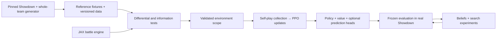

# Implementation plan: faithful simulator, strong policy, then search

Planning snapshot: 2026-10-10. **This is a proposed engineering and research program, not an implementation report.** Numerical gates are proposed requirements, not measured results. The original project's code and weights are unavailable; our objective is an independent implementation with reproducible strength, fidelity, and cost measurements. See the [research handoff](RESEARCH_HANDOFF.md) for the evidence behind that constraint.

Execution update: R1–R4 are implemented. The [R4 campaign handoff](R4_CAMPAIGN.md) records the current reference/data foundation; the learning, accelerated-engine and search milestones remain proposed.

## 1. Decisions to make now

| Decision | Proposed default | Reconsider when |
|---|---|---|
| Target | One pinned `gen9randombattle` format and generator revision; singles | A validated baseline exists; another format has a specific research purpose |
| Correctness oracle | Local Pokémon Showdown, exact Git SHA, lockfile, rules and configuration | Upstream drift is evaluated as a separate version |
| Training engine | Custom pure-JAX fixed-shape simulator, built incrementally | A candidate engine passes our own fidelity/performance audit and saves work |
| Policy | Small structured-input transformer, legal categorical actions, value head | Profiling or controlled ablation supports added complexity |
| Learning | Synchronous PPO + GAE; self-play; terminal outcome reward | Correctness and learning are established, then compare alternatives |
| Data | Official whole-team generator + our private self-play records | Demonstrations offer a measured warm-start benefit and usable provenance |
| Search | Off initially; then belief-averaged one-step lookahead, then simultaneous search | Base policy, engine and information tests pass |
| Infrastructure | Local CPU development; one rented NVIDIA GPU for profiling/training | Measured throughput or experiment parallelism justifies more GPUs |
| Prime Intellect | Candidate GPU provider; optional later LLM benchmark wrapper | Current offer and an end-to-end JAX benchmark justify it |

Do not anchor success to recreating a claimed ladder peak. Our first credible result is a fully specified agent that wins reproducible local Showdown matches against frozen baselines within a measured inference budget. Competitive ladder testing is a later deployment exercise.

## 2. System boundaries

Four types must stay distinct:

- `FullState`: engine truth, including both teams, exact HP, pending choices and random state. Used for simulation, diagnostics, and explicitly declared training labels.
- `PlayerView`: information available to one player at a named decision, including its own private request and revealed history. This is the actor interface.
- `BeliefState`: predictions and sampled hidden worlds derived only from that player's information and public priors.
- `TrainingTargets`: privileged labels allowed in loss computation, kept out of actor features and inference-time search inputs.

The initial policy and value heads share a **PlayerView-only** encoder. No privileged critic is included in this baseline. A future asymmetric critic would require a separate input/trunk interface and could not be used as the deployed search leaf evaluator.

Use a long-lived Node worker for reference episodes, official team generation and compiled data extraction. A versioned JSONL contract connects it to Python during testing and collection. The GPU training loop uses JAX arrays directly; it must not call Node or send JSON on every training step. Node owns Showdown protocol strings; Python owns the semantic-action-to-tensor codec. Details are in [Sprint 1](SPRINT_01.md).

Initial inference representation: global/field tokens, active Pokémon, candidate moves including Struggle, own and revealed opponent slots, and a bounded event history. Use explicit unknown indicators, masks and stable vocabularies. Begin with ordinary shared transformer blocks and event-derived memory. Treat specialized token MLPs, learned recurrence, matchup features and model size as later ablations. A nominal 4–10M parameter range is a starting design envelope, not a claim that matching the original parameter count is necessary.

## 3. Workstreams, milestones and schedule

Assign responsibilities even if one person fills multiple roles. The simulator owner owns mechanics; the learner owner owns PPO and buffers; the data/evaluation owner owns reference fixtures, splits and reports. One contract owner approves changes to phases, observations and actions across all three.

| Milestone | Deliverable | Exit evidence | Planning effort |
|---|---|---|---|
| M0: reference foundation | Pinned oracle, official teams, schemas, player views, phase fixtures, frozen splits | All R1–R7 tickets; replay and leakage checks; inventory of unsupported mechanics | 13–18 engineer-days plus integration buffer |
| M1: vertical slice | Restricted JAX battles and CPU-verifiable learner canaries | G1 and restricted G2; exact scope named; no silent mechanics fallbacks | 10–20 engineer-days |
| M2: useful restricted policy | Small PPO policy, opponent panel, profiling and resume | G3; improvement across three training seeds; measured complete-cycle cost | 5–10 engineer-days, overlaps mechanics work |
| M3: intended format | Expanded engine, transitive mechanics coverage, real Showdown adapter | G4; fresh differential campaign and adapter soak; full-format short training run | 20–40+ engineer-days; largest uncertainty |
| M4: strong base policy | Longer training, selected auxiliaries and snapshot league | Reproducible baseline-panel gains; no information violations; performance/cost report | 5–10 engineer-days plus chosen compute |
| M5: beliefs and search | Conditional worlds, shallow then deeper search, latency controls | G5 plus calibrated beliefs and gains over the same policy without search | 10–20 engineer-days |

These are engineering estimates, not quotations. Total is roughly **63–118+ person-days**. With two experienced contributors and useful overlap, reserve **8–16+ calendar weeks**; a solo implementation can take materially longer. Re-estimate after M0 and M1, when actual mechanics inventory and throughput are known. The original project's training run is not an estimate of simulator development effort.

Learning can begin on synthetic canaries and an explicitly restricted Pokémon profile while the engine expands. Full-format claims and expensive full-format training wait for M3. Search design on toy games can happen early, but production search integration waits for M4.

## 4. Data program

### Required data

1. **Versioned rules and tables.** Store Showdown SHA, generator/data hashes, resolved rules, PotD configuration, vocabularies, lockfiles and source attribution. Move/ability/item behavior includes executable code; JSON tables alone are insufficient. R1 selected the SHA recorded in [showdown.pin.json](../showdown.pin.json).
2. **Whole teams.** Generate an initial 100,000 teams from the pinned official factory for analysis and fixtures; enlarge or generate on demand as needed. Preserve correlations across sets and team composition, exact levels, EVs/IVs, item, ability, moves, Tera, forms and slots. Do not assemble teams by independently sampling marginal species/set frequencies.
3. **Reference episodes.** Initial target: 1,000 replayable local episodes plus adversarial phase/mechanics fixtures. Save explicit starting teams, seed type, input tape, private requests and normalized audit state. A state dump alone is not a reliable restart representation.
4. **Self-play stream.** Store per-player observations, observable action masks, sampled action, behavior-policy version, old log probability/value, rewards, terminal/truncation flags and next-decision linkage. Add privileged auxiliary labels through an isolated target path. Keep training buffers bounded; retain selected diagnostic trajectories, manifests, metrics and checkpoints instead of every full-state history forever.

Use separate random streams for team generation, mechanics and policy sampling. Assign the approximate 90/5/5 train/development/final split using a salted, versioned cryptographic hash of canonical team content, not generation seeds. The same exact team always lands in the same split; on-demand training generation accepts only train-assigned teams. Pair teams within a split and keep mirrored episodes together. Freeze final evaluation before tuning; choose checkpoints and configurations only on development data. Rule tables are common knowledge, while final sampled teams and outcomes remain outside training selection. The split deliberately withholds exact teams, not every species or individual set.

### Optional human data

Start without human replays. Consider replay pretraining only after the self-play baseline answers whether cold start is the bottleneck. Audit licensing, format, generator era, duplicates and missing information first. Spectator logs do not recover the player's complete private observation or all unrevealed sets. Train only labels justified by evidence, with masks/confidence; never fill missing private truth as if it were observed. The [handoff](RESEARCH_HANDOFF.md) documents candidate datasets and their limitations. No external dataset is a prerequisite for this plan.

## 5. Simulator accuracy program

Treat fidelity as a coverage ledger with counterexamples, not a single accuracy percentage. Inventory the official generator's possible mechanics and their transitive reachability through copying, move calling, transformations and related effects. A sampled team corpus estimates frequency; it cannot certify support.

Implement complete families and their interactions: ordinary damage/priority/accuracy; HP/PP/status/residuals; switching, pivots, trapping and replacement timing; boosts/fields; items and abilities; Tera/forms; copying/transformation and reachable rare effects. Every entry needs a source reference, support status, targeted fixture family and owner. Unsupported reachable behavior blocks that profile or fails explicitly.

Test at three levels: deterministic microcases, controlled stochastic outcome/distribution checks, and seeded whole battles with mismatch minimization. Identical numeric seeds across engines do not guarantee identical random events; either match the pinned generator and call schedule or compare semantic chance outcomes with a separately verified randomness harness. Test the harness itself against unmodified Showdown behavior.

Proposed release gates include at least 10,000 fresh reference battles in the declared scope, no unexplained disagreements, and 1,000 hidden-state perturbation cases. Counts do not replace targeted edge cases or establish complete correctness. Re-run affected fixtures on every mechanics change and the full campaign before promotion. See [acceptance gates](ACCEPTANCE_GATES.md) for statistical interpretation.

The phase machine must cover simultaneous actions, forced switches, pivot continuations, automatic resolution, termination, and rejection/re-request. A choice forbidden by the visible request is an adapter bug. A choice rejected because a hidden restriction becomes known is a rule-defined information event: preserve the attempted action and behavior probability, reproduce the reference feedback, and continue with a new request. Preserve the other player's pending commitment exactly as the reference requires. Transport retries are idempotent and are not new RL actions.

## 6. Learning program

Start with synchronous collection: freeze an actor snapshot, collect its rollout buffer, apply PPO updates, then collect with the new snapshot. This makes on-policy accounting auditable. Historical opponents remain frozen; train on the learner's own on-policy actions. If both sides use the learner snapshot, both valid trajectories may train it.

Implement the collection barrier explicitly. After a battle reaches its nominal quota, finish the current turn, replacements and rule-defined re-requests under the frozen actor until both players reach a fresh, uncommitted joint-action boundary, or the game terminates. Pause that battle there. Every included action must have its same-player next observation or terminal outcome before updating; compute nonterminal bootstrap values with the frozen actor. Allow and pad variable overflow, fail visibly on capacity exhaustion, and never carry an unresolved included transition into a new actor version. Tiny initial canaries may collect whole episodes instead. Add fixtures where quotas are hit during a pivot, a rejection and a double replacement.

Index trajectories by **each player's actual decisions**, not raw simulator microsteps. Maintain correct perspective through forced replacements and pauses. Terminal outcome reward is win=1, draw=0.5, loss=0 with gamma=1; use no dense battle reward initially. Bootstrap nonterminal buffer cuts from that player's next decision; do not bootstrap terminal games. Separate reference-defined tie termination from artificial training truncation.

Proposed first smoke settings: learning rate 3e-4, PPO clip 0.2, GAE lambda 0.95, two epochs, gradient norm cap 1, 256 parallel battles before scaling toward 1,024, and buffers targeting 128 decisions per player with explicit cut handling. These are starting hypotheses, not recovered original hyperparameters. Tune from observed KL, clip fraction, entropy, value calibration and advantage scale. Turn off auxiliary/exploration terms in algorithmic canaries where they would change the known optimum.

Loss components: clipped policy objective + value regression to detached return targets − entropy bonus; optional zero-avoidance penalty `KL(U_legal || policy)` with a separately tuned coefficient; optional set and opponent-action prediction losses. The KL direction is deliberate. Keep actor masking, probability computation and stored log probabilities consistent. A single available action contributes no actor learning signal, but its state may still train value/prediction heads.

Run the experiment ladder in order:

| Experiment | Question and decision |
|---|---|
| E0 | Do hand-computed returns, PPO ratios, tiny bandits and delayed-reward canaries pass? Stop on failure. |
| E1 | Does the smallest policy learn a restricted game in all three seeds? Establish learning and cost curves. |
| E2 | Does a small lambda/exploration screen improve stability? Change one factor at a time; no broad grid. |
| E3 | Do hidden-set and opponent-action heads help? Compare separately, then together; measure calibration and leakage. |
| E4 | Does a frozen snapshot opponent pool reduce cycling? Compare against current-self-play under the same budget. |
| E5 | Does the selected recipe work on the complete intended format? Compare restricted warm start with fresh training. |
| E6 | Do correlated beliefs and one-step lookahead improve the same base policy? Fix inference-time budgets. |
| E7 | Does deeper simultaneous search justify its latency? Sweep worlds, rollouts and depth under equal wall time. |
| E8 | Can distillation, recurrence, specialist MLPs or size improve the measured frontier? Add only after the simpler gains survive. |

Each experiment card records hypothesis, exactly changed variables, code/data/environment IDs, seeds, decision and GPU-hour budgets, primary metric, stopping rule, result and promotion decision. Cheap screens may use one seed; consequential selection must be confirmed with at least three independent training seeds, preferably five when affordable. Match sampled decisions and GPU-hours in separate comparisons because they answer different questions.

Checkpoint only at completed update/collection boundaries first. For exact continuation of persistent games, save live states, phase/request state, observations/private histories, pending commitments if any, weights, optimizer/schedule, counters, all random streams, versions and atomic checksums. Test a restore at that supported boundary before jobs longer than two hours. A crash midway through collection or optimization rolls back to the last complete checkpoint; discard and account for work since it, rather than splicing buffers across actor versions. Exact mid-rollout or mid-epoch continuation is a later optional mode requiring partial buffers, actor snapshots, permutations/cursors and its own interruption tests. Any recovery that resets active games must be labeled non-exact and record lost samples; it cannot pass the exact-continuation gate.

## 7. Belief and search program

First evaluate hidden-set predictions on controlled self-play labels: cross-entropy/Brier score, reliability curves, support failure rate and constraint satisfaction at successive reveal counts. Benchmark easy priors before learned proposals.

World sampling must respect known facts and team/set correlations. Pure rejection from a fixed unconditional team pool will collapse after enough reveals. Use conditional completion based on compatible set templates and generator constraints; record approximation and fallback status. Do not call this an exact posterior or use importance weights unless proposal/target probabilities are available. Test zero through six revealed slots, contradictory inputs, transformed Pokémon and rare legal sets. A zero-support fallback must be visible in metrics and cannot silently violate revealed facts.

Hold one sampled world fixed through a rollout. Start with a fixed observation-only opponent policy and average one-step action values over worlds and chance. Root decisions may depend on our private information; simulated opponent actions may depend only on that opponent's information. Test action distributions and search backups, not only network inputs: determinized full-state optimization can leak secrets even behind a masked encoder.

Only then test simultaneous deeper search. Use matrix games and rock-paper-scissors to expose pure-action exploitation and strategy-fusion mistakes. Preserve stochastic root action selection as the baseline. The original search heuristic is a candidate, not an equilibrium solver; passing toy tests does not prove Pokémon exploitability bounds. Track total simulations explicitly: worlds × simulations per world = total budget. Compare search to the identical policy without search and include latency timeouts with a legal-policy fallback.

## 8. Evaluation and promotion

All headline strength results come from real pinned Showdown matches. Start with random legal and damage-greedy baselines, then frozen learner checkpoints and separately runnable established bots whose format compatibility is verified. Use multiple opponent styles and an independently trained challenger to look for exploits. Do not interpret current self-play's roughly 50% score as learning.

Pair teams, swap seats, and score wins/draws/losses as 1/0.5/0. Bootstrap whole pairs, stratified by opponent; account separately for training-seed variation. Common battle seeds need not couple the same chance events after different decisions. Keep final confirmatory matches separate from development selection.

Proposed direct head-to-head screens: 1,000 pairs (2,000 games), then 5,000 pairs (10,000 games) for promotion. Worst-case approximate 95% half-widths for bounded pair scores are 3.1 and 1.4 percentage points; these are precision illustrations, not power guarantees. Candidate-minus-baseline differences against another opponent have different variance and require pilot-based sizing. Freeze the sample-size/stopping plan before confirmation.

Promotion requires fidelity/information gates first, then repeatable gains and a cost/latency report. A proposed search target is ≥2 percentage points direct score improvement, lower confidence bound above 50%, no material opponent-panel regression, and p99 latency within the chosen deployment budget. Predefine what counts as a material regression. A failed strength gate means diagnose data/learning/opponents, not automatically buy a larger run.

## 9. Compute and storage envelope

No budget has been selected or spending authorized by this plan. Start with CPU reference work; choose hardware from complete collect/update profiling. Compare at least one modest GPU candidate with a higher-memory/faster candidate only when the expected savings justify the benchmark. Do not assume a small network implies a small simulator state, nor that the GPU with the lowest hourly price has the lowest cost per useful decision.

An illustrative pilot cap is **140 total GPU-hours across all seeds and evaluations**:

| Allocation | GPU-hours |
|---|---:|
| Installation, compilation and end-to-end profiling | 4 |
| Learning smoke tests and resume/soak | 12 |
| Three small pilot seeds, 8 hours each | 24 |
| One selected configuration, three seeds × 24 hours | 72 |
| Evaluation/search microbenchmarks | 12 |
| Failed-run/retest allowance | 16 |
| Total | 140 |

This is a sequencing envelope, not a prediction of games played or competitive strength. For hypothetical rates of $2/$4/$8 per GPU-hour, GPU subtotal is $280/$560/$1,120; with a planning reserve equal to 20% it is $336/$672/$1,344. Actual storage, CPU evaluation, network charges and taxes need a provider quote; the reserve is not a guarantee. A $500–$1,000 pilot is plausible only at a compatible offer and measured throughput. Stop or shorten the ladder if the cap cannot support it.

If `q` is steady-state complete collect/update decisions per second, `H` the total GPU-hour allocation and `S` setup/compilation seconds, budget at most `N = q × (3600H − S) / 1.25` decisions under a 25% additive time-overhead convention. Deduct other separately budgeted non-training time as well; do not charge the same overhead twice when measured throughput already includes it. Report environment-only and complete collect/update throughput separately. For perspective, 100M games in seven days would require about 165 games/second, but our implementation must earn its own benchmark. Do not budget from that published target alone.

Storage example: 100M games × 100 combined player decisions/game × 256 bytes/decision is 2.56TB before richer histories. This is illustrative arithmetic; measure our actual records. Use bounded training buffers, compact sampled traces, checkpoint retention and durable manifest/metrics archives. Save crash-resumable state before considering interruptible offers.

## 10. First actions and decision points

R1–R7 are complete. The pinned oracle, versioned Node/Python contract, 100,000-team inventory and 1,000-episode exploratory campaign are documented in [R1_REFERENCE.md](R1_REFERENCE.md), [R2_CONTRACT.md](R2_CONTRACT.md), [R3_INVENTORY.md](R3_INVENTORY.md) and [R4_CAMPAIGN.md](R4_CAMPAIGN.md). R5's [player-history boundary](R5_FEATURES.md), R6's [conservative mechanics catalog](R6_MECHANICS.md), and R7's [partition gates and CPU benchmark](R7_SPRINT.md) complete M0. R3/R4 remain exposed exploratory data; R7 reserves 128 fresh final teams without evaluating them.

Next is **M1/G1: CPU learner canaries**, starting with hand-checkable returns/GAE, policy ratios, single-action cases, simple learning tasks and checkpoint/resume. Then define a restricted simulator profile with explicit R6 fixture obligations; unsupported mechanics must reject. Keep final data sealed during development. Re-estimate implementation effort after this slice and measure complete collect/update cost before selecting GPU hardware or Prime resources.

At the first review, decide from evidence: remaining mechanics surface, reference collection speed, information-test results and engineering capacity. At the GPU review, decide from measured end-to-end throughput and an actual offer. At the policy review, decide whether beliefs/search target observed failures. At the search review, decide whether distillation or more simulation offers better strength per dollar and per second.

**Prime is optional throughout.** Its practical near-term contribution is a plain GPU pod if it wins the price/performance check. Its LLM-oriented training stack is outside this custom JAX learner; a verifiers benchmark becomes useful only if we also want to evaluate or train language-model battle agents. See the [current assessment](PRIME_INTELLECT.md).
