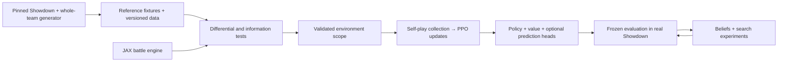

# Implementation plan: faithful simulator, strong policy, then search

> Publication note (2026-10-28): the status chronology below ends at F30 and is historical. See the [current project status](../README.md) and [F39 failure handoff](F39_ONLINE_CONTINUATION.md). Frozen scientific originals are preserved separately.

F30 stopped during production after 5,476.65 seconds of launcher elapsed time (91.28 minutes). All eight simulator workers hit the 60-second response deadline while starting the first random-opponent midpoint evaluation batch for seed 9311/control at cohort 512. The underlying cause remains unresolved. The partial run preserves 3,328 of 4,608 new cohorts, 26,624 optimizer steps, 3,407,872 selected rows, 128,144 training games, 9,984 opponent-evaluation games and 416 self-play diagnostic games. No exhaustive replay or successful completion seal ran, so no completed comparison or all-seed learning result is claimed. Original run evidence and frozen code remain unchanged; no restart or repair was performed. Full G2/G3/G4 and public strength remain open. No promotion, public server, final reserved data, Prime or GitHub publication. See [F30 handoff](F30_NONLINEAR_CONTINUATION.md).

F29 completed its fixed full-battle comparison in 3016.79 measured CPU seconds: 57,232 training games, 13,824 opponent games and 576 separate self-play diagnostic games. All-seed learning: {'control': False, 'nonlinear': True}; all-seed tactical feature benefit: False; secondary base-power benefit: True. All 27 contrasts retained: {'improvement': 11, 'inconclusive': 16}. The nonlinear actor passed its source-bound qualification checks (with sealed F25/F26/F27/F28 evidence reused) and the pinned build; exhaustive fresh replay reproduces all updates and games, 30 checkpoints and 12 original-next-update recoveries. The arms match selected rows, updates and refresh frequency, with identical initial predictions. Added nonlinear actor capacity can also alter shared-trunk gradients. Tactical is trained on: its adaptation gate is primary, and base-power benefit secondary. Predecessor evidence stays immutable. No promotion; full G2/G3/G4 and public strength remain open. No reserved data, public server, Prime or GitHub publication. See [F29 handoff](F29_NONLINEAR_POLICY.md).

F28 completed its fixed full-battle comparison in 1752.59 measured CPU seconds: 25,360 training games, 13,824 opponent games and 576 separate self-play diagnostic games. All-seed learning: {'large': False, 'small': False}; all-seed base-power batch benefit: False; trained-on tactical adaptation benefit: False. All 27 contrasts retained: {'inconclusive': 27}. The batch-size wrapper passed 15 focused qualification checks (with sealed F25/F26/F27 evidence reused) and the pinned build; exhaustive fresh replay reproduces all updates and games, 30 checkpoints and 12 original-next-update recoveries. The arms match rows and optimizer steps while differing in collection size and policy-refresh frequency. Tactical is trained on; adaptation is reported separately. Predecessor evidence stays immutable. No promotion; full G2/G3/G4 and public strength remain open. No reserved data, public server, Prime or GitHub publication. See [F28 handoff](F28_BATCH_COLLECTION.md).

F27 completed its fixed original-batch gradient audit in 95.85s on local CPU: 18 cohorts across all seeds/arms, 520 replayed training games, 29,586 decisions, 144 exact original steps and 12 next-checkpoint matches. All 13 focused tests and independent update replay pass. Every sampled joint update improves its actor surrogate; current critic/entropy removal has modest local effects. Game-half gradients disagree in 42/72 comparisons, but every sampled tactical batch has 2–4 wins, so zero-win batches are not the observed explanation. These are correlated diagnostics, not a strength gain or a causal noise diagnosis. Next proposed comparison: larger on-policy collection batches with matched selected-row/optimizer budgets and unchanged model/opponent mixture. No new campaign or promotion; full G2/G3/G4 and public strength remain open. No reserved data, public server, Prime or GitHub publication. See [F27 handoff](F27_GRADIENT_AUDIT.md).

F26 completed its fixed full-battle comparison in 1804.41 measured CPU seconds: 22,192 training games, 13,824 opponent games and 576 separate self-play diagnostic games. All-seed learning: {'mixed': False, 'self': False}; all-seed base-power mixture benefit: False; trained-on tactical adaptation benefit: False. All 27 contrasts retained: {'inconclusive': 26, 'regression': 1}. The opponent adapter passed 18 focused qualification checks (with sealed F25 checks reused) and the pinned build; exhaustive fresh replay reproduces all updates and games, 30 checkpoints and 12 original-next-update recoveries. Tactical is a trained-on heuristic; adaptation is reported separately. Predecessor evidence stays immutable. No promotion; full G2/G3/G4 and public strength remain open. No reserved data, public server, Prime or GitHub publication. See [F26 handoff](F26_OPPONENT_MIX.md).

F25 completed its fixed full-battle comparison in 3549.77 measured CPU seconds: 60,832 training games, 16,128 opponent games and 576 separate self-play diagnostic games. All-seed learning: {'matchup': False, 'zero': False}; all-seed matchup benefit: False. All 45 contrasts retained: {'improvement': 8, 'inconclusive': 37}. The corrected dynamic view passed 88 qualification checks and the pinned build; exhaustive fresh replay reproduces all updates and games, 48 checkpoints and 12 original-next-update recoveries. F23/F24 failure evidence stays immutable. No promotion; full G2/G3/G4 and public strength remain open. No reserved data, public server, Prime or GitHub publication. See [F25 handoff](F25_TERMINAL_MATCHUP.md).

F24 stopped before training after 68 qualification checks/build passed. The fixed run committed 656 reference games (all natural terminals; 43,625 decisions), then rejected a terminal Illusion observation with both actual Zoroark and its benched Mimikyu disguise marked active. A synthetic reducer test reproduces this pre-existing terminal identity/HP mapping defect in the older and new views. Training games and optimizer updates are zero; no learning result or successful completion receipt is claimed. Frozen source/evidence remain preserved and the monitor is paused. Next is a separately versioned own-identity/terminal reconciliation repair before another fixed comparison. Full G2/G3/G4 remain open; no final reserved data, public server, Prime or GitHub publication. See [F24 handoff](F24_DYNAMIC_MATCHUP.md).

F23 production failed before training:31 focused checks/build passed, but Double Shock produced a valid public typeless component (`???/Fighting`) rejected by the new matchup encoder.200 reference games were committed (all natural terminals;16,036 decisions); zero training games or optimizer updates occurred. The exact failure was reproduced for diagnosis; frozen source/evidence are preserved, with no automatic repair/restart or completed-screen/strength claim. Next proposed step is a separately versioned dynamic-type repair and qualification before a new fixed comparison, including the confirmed stale public type override after switching. See [F23 handoff](F23_MATCHUP_PPO.md). Full G2/G3/G4 and public strength remain open; Prime and final reserved data remain unused; GitHub visibility hold persists.

F22 completed (2026-10-25): qualified shared-policy/value PPO and ran the matched full-battle comparison. All three seeds completed 15,056 training games, 16,128 frozen-opponent games and 576 separate self-play diagnostic games in 1184.68 measured seconds on CPU. Learning gates passed in 0/3 flat seeds and 2/3 shared seeds; shared tactical benefit passed in 0/3. Neither all-seed learning gate passed, and no architecture is promoted. All 45 final contrasts are retained: 10 improvements, no detected regressions and 35 inconclusive results under the registered approximate bootstrap. All 14 focused qualification groups, exhaustive fresh replay, 66 checkpoint comparisons, 12 original-next-update recoveries and 19 copied-evidence rejection checks pass. Full G2/G3/G4 and public strength remain open; no final reserved data, public server, Prime or GitHub transfer. See the [F22 handoff](F22_SHARED_PPO.md) and [completion receipt](../artifacts/reports/f22-shared-ppo.json).

Next proposed step: qualify a function-preserving public matchup-feature adapter on the flat policy, then preregister a longer full-battle RL ablation against an identical augmented model with those new inputs zero-masked. Use all three final flat checkpoints, equal initialization and optimizer-reset rules, matched budgets, and F10 as the external reference. Flat is the experimental host because it retained familiar mastery; this is not policy promotion or a claim that representation caused tactical weakness. Keep event history and opponent-pool changes as separate interventions. F22 trained each learner on only 2,392–2,648 games, so sustained learning remains untested. Training collection used 405.83 seconds versus 21.35 seconds in optimizer calls; profile the collector before choosing GPU or Prime resources.

F21 completed (2026-10-25): evaluated all final F20 flat/shared checkpoints and the F10 rehearsal reference across 6,912 paired-development battle executions in 326.96 seconds on CPU, with zero optimizer updates or checkpoint selection. The shared-versus-flat battle-benefit gate passed in 0/3 seeds. All 27 contrasts remain: 2 improvements, 2 regressions and 23 inconclusive under the registered approximate adjusted bootstrap. Outcomes: 6,908 natural terminals, 4 unresolved cutoffs, 425,793 total attempted decisions and 214,191 learner decisions. All 21 focused tests, exhaustive fresh battle replay and nine immutable checkpoint loads pass. F20 familiar mastery failures remain; no policy is promoted. Full G2/G3/G4 and public strength remain open; no final reserved data, public server, Prime or GitHub transfer. See the [F21 handoff](F21_SHARED_BATTLE.md) and [original-objective review](OBJECTIVE_REVIEW_2026_10.md).

F21 falls in the mixed/inconclusive decision branch: retain F10 as the reference and do not claim a tactical winner. Next proposed step: return to full-battle RL with a controlled flat-versus-shared PPO comparison, starting from all three matched F20 final checkpoints and retaining F10 as an external reference. The shared scorer remains an unproven candidate: its matched-size implementation and limited random-opponent signal make RL learnability a testable hypothesis, not an established tactical benefit. First qualify the shared actor/value PPO loss, gradients and checkpoint recovery against the existing learner. Then preregister an equal decision/update budget and fixed-opponent learning curves; use battle improvement as the primary outcome, with familiar tactical cases and held-out self-play value diagnostics as supporting measures. Do not extend behavior cloning merely to improve teacher agreement. Structured observations, history, opponent auxiliary heads and historical-opponent cross-play remain separate candidate interventions. Measure complete-cycle cost before selecting a longer CPU or GPU budget. No new training is launched in F21; local CPU sufficed for this evaluation, and Prime remains unprovisioned.

F20 completed (2026-10-25): trained fresh flat and shared action-scoring models on the same frozen 2,048-game corpus, with identical sampled batches and 8,192 updates per arm/seed. All three seeds completed 49,152 updates / 6,291,456 row presentations in 161.97 seconds on CPU. Collected 256 fresh development teacher games (256 natural terminals, 0 cutoffs, 13,087 attempted decisions). Final voluntary-switch training agreement was 58.10–63.13% for flat and 21.12–23.47% for shared; fresh-probe agreement was 11.67–13.39% and 21.41–25.50%. The descriptive architecture gate passed in 0/3 seeds. All 28 focused tests, exhaustive replay, 30 checkpoint comparisons and 12 original-next-update recoveries passed. These are teacher-imitation results, not battle win rates. F10 remains the reference; full G2/G3/G4 and public strength remain open. No final reserved data, public server, Prime or GitHub transfer. See the [F20 handoff](F20_SHARED_POLICY.md).

Next proposed step: preregister a full-battle development evaluation of these frozen 8,192-update flat and shared checkpoints, alongside the existing F10 reference, against fixed random, base-power and tactical opponents. Keep all three seeds and identical paired battle schedules, report wins/losses and unresolved cutoffs separately, and carry the known Tera-variant failures into the assessment. Make no additional optimizer updates or checkpoint selection during this screen. It will test whether better teacher imitation translates into battle strength before choosing another training intervention; F20 does not establish that translation or authorize promotion. Local CPU remains sufficient for a bounded evaluation; no public ladder or final reserved evaluation.

F19 completed (2026-10-25): continued all three sealed F18 expanded checkpoints from 2,048 to 8,192 updates, preserving Adam state, the 106,149-row corpus, model and sampling. The run added 18,432 updates / 2,359,296 row presentations and 256 fresh development teacher games (256 natural terminals, 0 cutoffs, 13,017 attempted decisions). Voluntary-switch training agreement changed from 14.67–16.51% to 59.47–63.74%; fresh-probe agreement changed from 3.85–8.12% to 8.40–12.96%. The descriptive learning gate passed in 0/3 seeds. These are teacher-imitation metrics. All 16 focused tests, exhaustive fresh replay, 15 checkpoint comparisons and six original-next-update recoveries passed. F10 remains the reference; full G2/G3/G4 and public strength remain open. No final reserved data, public server, Prime or GitHub transfer. See the [F19 handoff](F19_LEARNING_CURVE.md).

Next proposed step: compare the existing flat policy with a shared action-scoring architecture that reuses parameters across Pokémon slots and legal move/switch choices. Use the same public information, frozen corpus, family sampling and preregistered update budget, with a matched control, fresh development probe and all three seeds. First verify action/slot remapping and hidden-information isolation. This tests a structural generalization hypothesis; F19 does not prove the architecture is the cause or that the new design will work. Do not expand data and architecture together, add more optimization after seeing results, promote a policy, or start PPO automatically. Local CPU remains sufficient for the bounded comparison.

F18 completed (2026-10-25): compared the original 512 teacher games with an expanded 2,048-game corpus, using the unchanged 928-feature model and 2,048 updates per arm/seed. Collected 1,536 additional training games and 256 fresh development teacher games (1,792 natural terminals, 0 cutoffs, 93,300 attempted decisions). All three seeds and both arms completed 12,288 updates / 1,572,864 row presentations. The descriptive learning gate passed in 0/3 seeds. Fresh-probe voluntary-switch agreement was 5.03–7.41% for original and 4.63–5.16% for expanded. These are teacher-imitation metrics, not battle win rates. All 21 focused checks, exhaustive replay, 18 checkpoint comparisons, six original-next-update recoveries and three exact F16 control matches passed. F10 remains the reference; full G2/G3/G4 and public strength remain open. No final reserved data, public server, Prime or GitHub transfer. See the [F18 handoff](F18_DATA_COVERAGE.md).

Next proposed step: measure a preregistered learning curve on the now-frozen expanded corpus, keeping the original model, sampling and optimizer fixed and comparing the existing 2,048-update budget with an 8,192-update endpoint on fresh development games. Expanded-corpus fit agreement was only 14.7–16.5%, so insufficient fitting remains plausible; this does not establish that extra updates will improve transfer. Track both fitting and fresh-probe agreement, preserve all seeds and other action families, and do not collect another training corpus or promote a policy from F18.

F17 completed (2026-10-25): replayed all 640 existing teacher games / 32,811 accepted decisions, then ran a fixed two-arm semantic-input canary with 12,288 BC updates and 1,572,864 row presentations. The descriptive representation gate passed in 0/3 seeds. Voluntary-switch agreement on the reused development probe was 3.27–7.37% for the zero-input control and 0.88–4.74% with explicit public type/move metadata. No new games or full-battle strength test occurred. All 28 focused checks and exhaustive update/prediction replay pass, including six original-next-update recoveries and 18 checkpoint comparisons. F10 remains the reference; full G2/G3/G4 and public strength remain open. Final reserved data, public servers and Prime were unused; GitHub remains held. See the [F17 handoff](F17_SWITCH_REPRESENTATION.md).

Next proposed step: test a larger, more diverse full-battle teacher corpus against the original corpus while keeping the original 928-feature model, balanced sampling and update budget fixed. Use a fresh development probe and preserve final reserved data. This tests data coverage separately; broader data is a candidate remedy, not an established one. No policy promotion or PPO continuation follows from this canary.

F16 completed (2026-10-24): balanced full-battle imitation reused 512 sealed teacher games and executed 6,144 new BC updates, 128 fresh teacher-probe games and 6,912 full-battle evaluation games in 314.59 seconds on local CPU. Both the descriptive coverage screen and the strength gate failed in all three seeds. Tera agreement improved to 39–43%, but ordinary-move agreement fell to 33–34% and voluntary-switch agreement reached only 3–7%. Tactical-opponent wins for initial/uniform/balanced were 40/49/38 out of 768 each (descriptive totals). All 27 registered contrasts remain: 3 improvements favoring uniform over initial, 1 balanced-versus-uniform regression against random, and 23 inconclusive results. Evaluation retains 6,907 natural terminals and five unresolved cutoffs. All 16 focused tests and exhaustive fresh replay pass, including 12 checkpoint comparisons and three original-next-update recoveries. F10 remains the reference; no PPO follow-on or policy promotion. Full G2/G3/G4 and public strength remain open. Final reserved data, public servers and Prime were unused; GitHub remains held. See the [F16 handoff](F16_BALANCED_IMITATION.md).

Next proposed work: audit the existing voluntary-switch decisions for observable-state feature loss, teacher-label ambiguity and narrow training coverage; use those findings to preregister one controlled encoding or data-diversity intervention. Do not begin another PPO continuation, broaden budgets or promote balanced imitation from this failed screen. Fresh development teams exclude training and F15 panels, but known mechanics, species and opponents recur.

F15 completed (2026-10-24): full-battle tactical demonstrations plus matched RL continuations collected 512 training teacher games, 128 separate teacher-probe games, 8,440 RL training games and 4,608 evaluation games in 416.28 seconds on local CPU. All three preregistered benefit gates failed in every seed (0/3 each). Teacher agreement improved from about 25% to 43% after imitation, then fell to 37–39% after RL; tactical-opponent strength remains unestablished. All 16 focused tests and exhaustive fresh replay pass, including nine original-next-update recoveries. The 45 contrasts contain 4 improvements, 4 regressions and 37 inconclusive cells under the registered approximate-bootstrap test. Evaluation retains 12 unresolved cutoffs. F10 remains the reference. Full G2/G3/G4 and public strength remain open; final reserved data, public servers and Prime were unused. GitHub remains on the existing visibility hold. See the [F15 handoff](F15_FULL_IMITATION.md).

F14 completed (2026-10-24): the matched-budget entropy ablation collected 4,512 training and 864 evaluation continuations in 169.41 seconds on local CPU. The preregistered no-entropy benefit gate passed in 0/3 seeds; the descriptive two-point switch-reduction threshold was met in 0/3. All 18 contrasts are retained (0 improvements, 0 regressions, 18 inconclusive under the registered approximate-bootstrap test). Training/evaluation natural terminals: 4,512/864; cutoffs: 0/0. All 14 focused tests and exhaustive replay pass, including six original-next-update recoveries. This adaptively reused development bank does not establish fresh-team or full-battle generalization. F10 remains the reference. Full G2/G3/G4 and public strength remain open; final reserved data, public servers and Prime were unused. GitHub remains on the existing visibility hold. See the [F14 handoff](F14_ENTROPY_ABLATION.md).

F13 completed (2026-10-24): the credit-assignment and continuation canary collected 4,536 training and 864 evaluation continuations in 203.34 seconds on local CPU; all ended naturally. The registered lambda=1 benefit gate did not pass (0/3 seeds); all 18 contrasts were inconclusive. No new policy is promoted; F10 remains the reference. Independent return calculations agree with sealed GAE, and fixed-state probes confirm that F12 increased switching propensity. The new public-state-selected bank has 48 midgame/endgame starts from 192 official train-partition teacher games. Both arms received equal selected-row and optimizer-step budgets. All 15 focused tests and exhaustive replay pass, including six original-next-update recoveries. Full G2/G3/G4 and public strength remain open; final reserved data, public servers and Prime were unused. GitHub remains on the existing visibility hold. See the [F13 handoff](F13_CREDIT_ASSIGNMENT.md).

F12 completed (2026-10-24): the fixed curriculum comparison collected 12,848 training and 6,912 evaluation games in 694.16 seconds on local CPU. The preregistered curriculum-benefit gate did not pass (0/3 seeds). Under the registered approximate-bootstrap test, both arms regressed against base-power in every seed; curriculum also regressed against the control on random/base-power in seed 9311. Neither new arm is promoted over the prior F10 baseline. Both arms received 384 Adam steps per seed and identical PPO/rehearsal budgets; only the starting-state mixture differed, with both training against the same frozen tactical opponent. All 17 focused tests pass. Fresh independent replay reproduces every training cohort, selected batch, optimizer update, all 6,912 evaluation games, 18 stage checkpoints and six original-next-update recoveries. Full G2/G3/G4 and public ladder/generalization claims remain open. Final reserved data, public servers and Prime were unused; GitHub remains on the existing visibility hold. See the [F12 handoff](F12_CURRICULUM_LEARNING.md).

F11 completed (2026-10-24): audited all 3,072 final F10 tactical-opponent games and 78,744 learner decisions. There were 54,900 heuristic disagreements; these are screening signals, not automatic error labels. Among 62 fixed single-action alternatives, 7 changed a loss to a win, 3 worsened a win to a loss, and 52 left the terminal reward unchanged; all ended naturally. Built 65 executable train-only starts from 96 fresh official train games, meeting all seven family quotas with verified unsolved handoffs and full-battle continuations. All 35 focused tests and independent replay pass. No optimizer updates or new playing-strength claim. Next is a preregistered matched-budget curriculum ablation; full G2/G3/G4, public strength and generalization remain open. Final data, public servers and Prime were unused; GitHub stays on the existing visibility hold. See the [F11 handoff](F11_BATTLE_DECISIONS.md).

F10 completed (2026-10-24): the fixed longer full-battle comparison collected 12,256 training and 13,824 evaluation games in 1051.30 seconds on local CPU. All-seed full-battle learning gates under the registered approximate-bootstrap development test: plain passed, rehearsal passed; secondary all-seed tactical-retention benefit passed. Both arms received 1,024 new Adam steps per seed (6,144 total), with 786,432 selected PPO rows and 393,216 extra supervised row presentations in the rehearsal arm. All 28 focused tests pass; fresh replay reproduces every full game, batch, update, tactical prediction, 48 periodic checkpoints and six original-next-update recoveries. This is development evaluation against known opponents and scenario families. Full G2/G3/G4 remain open; public servers, final reserved data and Prime were unused. GitHub remains on the existing visibility hold. See the [F10 handoff](F10_LONG_TRANSFER.md).

Both arms improved against random and base-power opponents. Rehearsal retained the known tactical skills in 3/3 seeds versus plain PPO's 0/3, but all nine rehearsal-minus-plain full-battle contrasts remain inconclusive: superiority and equivalence are unestablished. Pooled tactical-opponent wins remain only 4.43% for plain PPO and 4.23% for rehearsal. The critic beats constant 0.5, but a post-hoc constant fitted to each same evaluation cell beats it on random and tactical opponents; calibration and broader transfer remain open.

F9 v2 completed (2026-10-24): the fixed full-battle transfer pilot collected 1,448 training and 1,728 evaluation games in 161.80 seconds on local CPU. The all-seed supervised-rehearsal benefit gate passed. Both arms received 128 new Adam steps per seed (768 total), with 98,304 selected PPO rows and 49,152 extra supervised row presentations in the rehearsal arm. All 20 focused tests pass; fresh replay reproduces every full game, selected batch, update, tactical prediction and six original-next-update checkpoints. This is a small development pilot with known tactical templates, not a public-strength result. Full G2/G3/G4 remain open; public servers, final data and Prime were unused. See the [F9 handoff](F9_FULL_TRANSFER_V2.md).

Tactical retention passed in all three rehearsal seeds and failed in all three plain-PPO seeds. Rehearsal increased final correct-action probability over plain PPO by 8.81, 12.10 and 9.31 percentage points. Neither arm passed the full-battle learning gate in any seed; all rehearsal-versus-plain win-rate contrasts were inconclusive. Terminal-only value MSE remained around 0.25, with mean values near 0.5.

F9 v1 failed before training (2026-10-24): the new admission guard incorrectly disallowed legitimate Showdown unavailable-choice feedback. A bounded replay of the original initial-policy prefix reproduced two trapped-switch responses in development episode7, both seat orientations; the sealed collector refreshed requests correctly. No optimizer update or learning result exists. The failed source, run and diagnostic are preserved; a separate corrected version keeps the same seeds and training budget. See [F9 v1 handoff](F9_FULL_TRANSFER.md).

**F8 completed (2026-10-24):** The [matched-budget PPO comparison](F8_DECISION_RETENTION.md) collected 49,152 training and 6,144 evaluation decisions in 320.98 seconds on local CPU. The supervised-initialization retention gate **failed** (0/3 seeds), due to probability drops in variant contexts. All three supervised arms nevertheless retained **100% greedy accuracy**, versus **25% for fresh arms**, and passed the final probability-advantage gate. Improvement remains incomplete across families. Both arms received 128 new Adam steps per seed; the supervised arm also had F7's prior supervision. All 25 focused tests, every simulator decision/branch and all PPO/checkpoint replays pass. These are local one-decision HP-retention cases with repeated development inputs; no full battles or playing-strength result. Full G2/G3/G4 remain open. Final data, public servers and Prime were unused.

**F7 completed (2026-10-24):** The [supervised fit diagnostic](F7_DECISION_FIT.md) reached **100% final argmax accuracy on all 512 states in all three seeds**, but **all preregistered probability gates failed**. Minimum training-context target probabilities were 86.31%, 89.77% and 89.81%, below the 95% requirement. The unchanged network can express these finite greedy choices; reliable stochastic mastery and the cause of F6's RL failure remain unresolved. The fixed run used 3,072 Adam steps and 393,216 row presentations in 3.38 seconds on CPU, with no new games. All 15 focused tests and exhaustive update/checkpoint replay pass. Full G2/G3/G4 remain open; final data, public servers and Prime were unused. Proposed next: matched-budget fresh-versus-supervised-initialization PPO comparison with fresh development realizations, all seeds retained and conditional-choice retention measured; no additional run has started.

**F6 completed (2026-10-24):** The [decision-point canary](F6_DECISION_CANARY.md) completed 24,576 one-decision training cases and 1,536 evaluation cases in 142.19 seconds on local CPU. The preregistered local learning gate **failed in all three seeds**. The final policies chose Tera almost regardless of context; correct-switch probability fell below 1%. These cases optimize one-turn HP retention, not battle wins. All 96 separate frozen-policy continuation checks completed: 96 natural terminals and 0 cutoffs. All 70 focused tests pass; every training/evaluation decision, PPO update and continuation game reproduced in fresh replay. This does not establish curriculum transfer or public strength; full G2/G3/G4 remain open. Final data and Prime were unused.

**F5 completed (2026-10-23):** [Opponent-mixture comparison](F5_OPPONENT_MIXTURE.md) completed **19,232 training + 13,824 evaluation games** in 1947.61 seconds (32.5 minutes) on local CPU. The preregistered exploratory mixture gate **did not pass**; all three seeds, both arms and 27 contrasts are retained. Each seed–arm received 131,072 selected learner rows and 1,024 Adam steps (786,432 rows / 6,144 steps overall). No tactical improvement over self-play was established; observed tactical wins were lower in every mixture seed. One base-power comparison showed a regression under the approximate bootstrap test. The mixture required 13,184 training games versus 6,048 for self-play and is not promoted. There were 32,968 natural terminals and 88 cutoffs. All 86 focused tests pass; bounded original-update and evaluation replay passes. This measures fresh development games against known heuristic identities, not public ladder or unseen-opponent strength. Full G2/G3/G4 remain open; final data and Prime were unused.

**F4 completed (2026-10-22):** [Full-Showdown learning screen](F4_FULL_LEARNING.md) completed **12,288 training + 18,432 evaluation games** in 2,058.68 seconds (34.3 minutes) on local CPU. All three seeds and nine initial/final opponent comparisons are retained; the preregistered exploratory learning gate **passed**. There were 30,626 natural terminals, 94 explicit cutoffs, 2,367,153 decisions and 9,570 Adam steps. All 64 focused tests pass; bounded replay exactly reproduced the original last cohort/update for every seed and the first paired matchup in every endpoint/opponent cell. This is development learning evidence, not a public-strength result; full G2/G3/G4 remain open. Final data and Prime were unused.

F3 performance update (2026-10-22): [CPU/Metal throughput comparison](F3_THROUGHPUT.md) completed. Eight persistent CPU workers with batched player-only inference achieved 1.87× warm collection throughput (48 matched games: 5.105 → 2.727 seconds). On the same isolated Python/JAX runtime, Metal took 4.841 seconds versus CPU 3.088 seconds, 57% longer. Actual Metal execution and bounded numerical/sampler checks pass. All 47 focused tests pass; actions/outcomes match and next updates agree within tolerance, not byte-for-byte. This is a fixed-policy throughput benchmark, not a new learning screen or strength claim. Keep the current CPU runtime and reuse workers. F2 evidence is preserved; full G2/G3/G4 remain open.

F2 execution update (2026-10-22): [full-Showdown training](F2_FULL_TRAINING.md) completed the fixed three-seed replacement pilot: 768 training + 768 development games, 1,516 natural terminals / 20 cutoffs, 157,983 decisions, 798 Adam steps, 207.45 seconds on local CPU. Observed wins increased in all six seed/opponent cells, but every preregistered gate is inconclusive; value error improved against random and worsened against base power. All 42 focused tests pass; replaying each final cohort exactly reproduced model/optimizer state. The first F2 attempt and its own-Illusion wait-request repair are preserved separately. The completion inventory verifies source/evidence hashes and counters. M7 remains failed; full G2/G3/G4 and public ladder strength remain open. Final data and Prime were unused.

Planning snapshot: 2026-10-10. **This is a proposed engineering and research program, not an implementation report.** Numerical gates are proposed requirements, not measured results. The original project's code and weights are unavailable; our objective is an independent implementation with reproducible strength, fidelity, and cost measurements. See the [research handoff](RESEARCH_HANDOFF.md) for the evidence behind that constraint.

Execution update (2026-10-11): R1–R7 complete the reference/data foundation. M1/G1 learner canaries pass; a restricted JAX public duel has fresh Showdown parity, an observation-only learner and a passing [selected policy/chance two-hour CPU qualification](M1_POLICY_SOAK.md). The [restricted-policy pilot](M2_POLICY_PILOT.md) now passes its preregistered random-opponent learning screen in all three seeds over 54,000 real Showdown games. Full G2/G3, broader-format mechanics, competitive strength and search remain open. Section 10 records the current evidence.

Playable-baseline update (2026-10-11): the [Showdown client and heuristic](PLAYABLE_BASELINE.md)
bring forward the deployment/evaluation interface from M3 without claiming full
custom-engine coverage. Three actual local WebSocket games pass, and 64 paired
development games give 60 wins against the weak random policy with exact replay of
2,904 decisions. Public-server authentication and ladder strength are untested.
The next deployment step is a chosen account's direct challenge after verifying
current server requirements; simulator expansion continues separately. Local CPU
remains sufficient and no Prime resources were used.

Recovery update (2026-10-11): an additive [session layer](SHOWDOWN_SESSION.md)
recovers known active battles from fresh player-visible history and the server's
current request. Six local-server games pass seven injected disconnects and a wire
audit of all 120 attempted decisions; 303 tests pass with 254 unchanged tested
source/configuration files. The unchanged heuristic gains bounded
transport recovery, not strategic strength. The [deployment note](SHOWDOWN_DEPLOYMENT.md)
records the newly verified bot-registration announcement and unresolved rollout.
Next supply account/opponent details for a controlled public challenge after
establishing applicable requirements; the frozen local opponent panel is now
complete as recorded below. The switching/hidden-set scalar/JAX port and full G2/G3 stay open.

Opponent-panel update (2026-10-11): the [frozen four-policy matrix](SHOWDOWN_OPPONENT_PANEL.md)
completes 768 development games in six matchups, each with 64 mirrored pairs.
All 35,711 decisions replay exactly; 338 tests pass with 266 tested files unchanged.
Tactical scores 58.59% against baseline and 57.03% against damage, while its random
score is 89.84% versus baseline's 92.19%. Per-edge paired intervals are descriptive,
not adjusted promotion evidence. The original network policy remains qualified
and unchanged. Fresh confirmation and the new network adapter follow below.
No training, public matches, reserved final
data or Prime resources were used; the scalar/JAX expansion and G2/G3 stay open.

Tactical-confirmation update (2026-10-11): the [fresh development screen](SHOWDOWN_TACTICAL_CONFIRMATION.md)
completes all 12,000 fixed games using 2,000 independently admitted development
teams. All 564,379 actor inputs/actions, outcomes and bounds reproduce in fresh
simulator replay. The unchanged tactical policy scores 60.65% directly against baseline;
its nominal adjusted lower bound is 58.55%, above the declared 50% boundary, and
its point estimate exceeds 52%. Paired improvements over baseline are +2.20
percentage points against random and +10.05 against damage; their lower bounds
are +0.80 and +7.40 points, both above the predeclared −3-point tolerance. All
three conditions pass. These approximate bootstrap bounds qualify the local
development candidate, not a final-data or ladder promotion.

The additive tactical client completes six local-server games and seven injected
disconnects with 179 wire-reconstructed attempted decisions. All 380 tests pass
with 283 unchanged tested source/configuration files. Use `npm run bot:tactical`
for the explicit local candidate; the baseline command remains available. The
subsequent local network soak is recorded below; the next implementation work is
the switching/hidden-set scalar/JAX and categorical learner.
Public deployment still needs account details and applicable server requirements.
No learned full-format policy, G2/G3/G4 closure or #1 readiness is established.
Local CPU remains sufficient; final data remain reserved and Prime is unnecessary.

Network-soak update (2026-10-11): the [frozen local campaign](SHOWDOWN_NETWORK_SOAK.md)
passes all 1,000 real loopback games, 980 rematches and 60 planned recoveries across
20 sessions. The complete audit reconstructs 46,024 decisions and matches exact
server-side own-team receipts; zero unavailable-choice retries occur. Campaign
elapsed time is 169.097 seconds, with 445.063 MiB peak sampled client RSS. All 426
source-bound tests pass on 298 unchanged files. The exact official development
pool is admitted without constructed-legality edits; all Random Battle rules are
preserved. This completes only the local adapter volume prerequisite. Full G2/G3/G4,
public deployment and measured ladder strength remain open. Next implement the M3
scalar/JAX transition and view reducer against its sealed switching/hidden-set
reference contract, then conditional/fresh parity and the categorical learner.
Keep the public-duel learner and all earlier evidence sealed. CPU remains sufficient;
no final data, training or Prime resources were used in the network soak.

M3 engine update (2026-10-11): the [switching/hidden-set scalar and JAX port](M3_SWITCH_ENGINE.md)
passes all 72 sealed cases and 10,000 fresh Showdown games: 136,635 state boundaries,
273,270 player views, 241,384 decisions and 332,815 recorded chance draws agree.
The four-action player-only learner completes the fixed three-seed smoke of 192 updates,
6,144 primary games and 140,983 decisions. Six original-next-update replays, nine
checkpoint loads, six transaction-discard checks and 443 source-bound tests pass.
Earlier public-duel learners and the tactical full-battle heuristic remain sealed.
Next qualify this exact categorical/switching configuration with its own sustained
CPU campaign, then preregister a restricted strength screen with explicit handling
of unfinished games. Full-format mechanics, G2/G3/G4, public deployment, ladder
strength and search remain open. Final data stay unused; Prime is unnecessary.

## 1. Decisions to make now

| Decision | Proposed default | Reconsider when |
|---|---|---|
| Target | One pinned `gen9randombattle` format and generator revision; singles | A validated baseline exists; another format has a specific research purpose |
| Correctness oracle | Local Pokémon Showdown, exact Git SHA, lockfile, rules and configuration | Upstream drift is evaluated as a separate version |
| Training engine | Custom pure-JAX fixed-shape simulator, built incrementally | A candidate engine passes our own fidelity/performance audit and saves work |
| Policy | Small structured-input transformer, legal categorical actions, value head | Profiling or controlled ablation supports added complexity |
| Learning | Synchronous PPO + GAE; self-play; terminal outcome reward | Correctness and learning are established, then compare alternatives |
| Data | Official whole-team generator + our private self-play records | Demonstrations offer a measured warm-start benefit and usable provenance |
| Search | Off initially; then belief-averaged one-step lookahead, then simultaneous search | Base policy, engine and information tests pass |
| Infrastructure | Local CPU development; one rented NVIDIA GPU for profiling/training | Measured throughput or experiment parallelism justifies more GPUs |
| Prime Intellect | Candidate GPU provider; optional later LLM benchmark wrapper | Current offer and an end-to-end JAX benchmark justify it |

Do not anchor success to recreating a claimed ladder peak. Our first credible result is a fully specified agent that wins reproducible local Showdown matches against frozen baselines within a measured inference budget. Competitive ladder testing is a later deployment exercise.

## 2. System boundaries

Four types must stay distinct:

- `FullState`: engine truth, including both teams, exact HP, pending choices and random state. Used for simulation, diagnostics, and explicitly declared training labels.
- `PlayerView`: information available to one player at a named decision, including its own private request and revealed history. This is the actor interface.
- `BeliefState`: predictions and sampled hidden worlds derived only from that player's information and public priors.
- `TrainingTargets`: privileged labels allowed in loss computation, kept out of actor features and inference-time search inputs.

The initial policy and value heads share a **PlayerView-only** encoder. No privileged critic is included in this baseline. A future asymmetric critic would require a separate input/trunk interface and could not be used as the deployed search leaf evaluator.

Use a long-lived Node worker for reference episodes, official team generation and compiled data extraction. A versioned JSONL contract connects it to Python during testing and collection. The GPU training loop uses JAX arrays directly; it must not call Node or send JSON on every training step. Node owns Showdown protocol strings; Python owns the semantic-action-to-tensor codec. Details are in [Sprint 1](SPRINT_01.md).

Initial inference representation: global/field tokens, active Pokémon, candidate moves including Struggle, own and revealed opponent slots, and a bounded event history. Use explicit unknown indicators, masks and stable vocabularies. Begin with ordinary shared transformer blocks and event-derived memory. Treat specialized token MLPs, learned recurrence, matchup features and model size as later ablations. A nominal 4–10M parameter range is a starting design envelope, not a claim that matching the original parameter count is necessary.

## 3. Workstreams, milestones and schedule

Assign responsibilities even if one person fills multiple roles. The simulator owner owns mechanics; the learner owner owns PPO and buffers; the data/evaluation owner owns reference fixtures, splits and reports. One contract owner approves changes to phases, observations and actions across all three.

| Milestone | Deliverable | Exit evidence | Planning effort |
|---|---|---|---|
| M0: reference foundation | Pinned oracle, official teams, schemas, player views, phase fixtures, frozen splits | All R1–R7 tickets; replay and leakage checks; inventory of unsupported mechanics | 13–18 engineer-days plus integration buffer |
| M1: vertical slice | Restricted JAX battles and CPU-verifiable learner canaries | G1 and restricted G2; exact scope named; no silent mechanics fallbacks | 10–20 engineer-days |
| M2: useful restricted policy | Small PPO policy, opponent panel, profiling and resume | G3; improvement across three training seeds; measured complete-cycle cost | 5–10 engineer-days, overlaps mechanics work |
| M3: intended format | Expanded engine, transitive mechanics coverage, real Showdown adapter | G4; fresh differential campaign and adapter soak; full-format short training run | 20–40+ engineer-days; largest uncertainty |
| M4: strong base policy | Longer training, selected auxiliaries and snapshot league | Reproducible baseline-panel gains; no information violations; performance/cost report | 5–10 engineer-days plus chosen compute |
| M5: beliefs and search | Conditional worlds, shallow then deeper search, latency controls | G5 plus calibrated beliefs and gains over the same policy without search | 10–20 engineer-days |

These are engineering estimates, not quotations. Total is roughly **63–118+ person-days**. With two experienced contributors and useful overlap, reserve **8–16+ calendar weeks**; a solo implementation can take materially longer. Re-estimate after M0 and M1, when actual mechanics inventory and throughput are known. The original project's training run is not an estimate of simulator development effort.

Learning can begin on synthetic canaries and an explicitly restricted Pokémon profile while the engine expands. Full-format claims and expensive full-format training wait for M3. Search design on toy games can happen early, but production search integration waits for M4.

## 4. Data program

### Required data

1. **Versioned rules and tables.** Store Showdown SHA, generator/data hashes, resolved rules, PotD configuration, vocabularies, lockfiles and source attribution. Move/ability/item behavior includes executable code; JSON tables alone are insufficient. R1 selected the SHA recorded in [showdown.pin.json](../showdown.pin.json).
2. **Whole teams.** Generate an initial 100,000 teams from the pinned official factory for analysis and fixtures; enlarge or generate on demand as needed. Preserve correlations across sets and team composition, exact levels, EVs/IVs, item, ability, moves, Tera, forms and slots. Do not assemble teams by independently sampling marginal species/set frequencies.
3. **Reference episodes.** Initial target: 1,000 replayable local episodes plus adversarial phase/mechanics fixtures. Save explicit starting teams, seed type, input tape, private requests and normalized audit state. A state dump alone is not a reliable restart representation.
4. **Self-play stream.** Store per-player observations, observable action masks, sampled action, behavior-policy version, old log probability/value, rewards, terminal/truncation flags and next-decision linkage. Add privileged auxiliary labels through an isolated target path. Keep training buffers bounded; retain selected diagnostic trajectories, manifests, metrics and checkpoints instead of every full-state history forever.

Use separate random streams for team generation, mechanics and policy sampling. Assign the approximate 90/5/5 train/development/final split using a salted, versioned cryptographic hash of canonical team content, not generation seeds. The same exact team always lands in the same split; on-demand training generation accepts only train-assigned teams. Pair teams within a split and keep mirrored episodes together. Freeze final evaluation before tuning; choose checkpoints and configurations only on development data. Rule tables are common knowledge, while final sampled teams and outcomes remain outside training selection. The split deliberately withholds exact teams, not every species or individual set.

### Optional human data

Start without human replays. Consider replay pretraining only after the self-play baseline answers whether cold start is the bottleneck. Audit licensing, format, generator era, duplicates and missing information first. Spectator logs do not recover the player's complete private observation or all unrevealed sets. Train only labels justified by evidence, with masks/confidence; never fill missing private truth as if it were observed. The [handoff](RESEARCH_HANDOFF.md) documents candidate datasets and their limitations. No external dataset is a prerequisite for this plan.

## 5. Simulator accuracy program

Treat fidelity as a coverage ledger with counterexamples, not a single accuracy percentage. Inventory the official generator's possible mechanics and their transitive reachability through copying, move calling, transformations and related effects. A sampled team corpus estimates frequency; it cannot certify support.

Implement complete families and their interactions: ordinary damage/priority/accuracy; HP/PP/status/residuals; switching, pivots, trapping and replacement timing; boosts/fields; items and abilities; Tera/forms; copying/transformation and reachable rare effects. Every entry needs a source reference, support status, targeted fixture family and owner. Unsupported reachable behavior blocks that profile or fails explicitly.

Test at three levels: deterministic microcases, controlled stochastic outcome/distribution checks, and seeded whole battles with mismatch minimization. Identical numeric seeds across engines do not guarantee identical random events; either match the pinned generator and call schedule or compare semantic chance outcomes with a separately verified randomness harness. Test the harness itself against unmodified Showdown behavior.

Proposed release gates include at least 10,000 fresh reference battles in the declared scope, no unexplained disagreements, and 1,000 hidden-state perturbation cases. Counts do not replace targeted edge cases or establish complete correctness. Re-run affected fixtures on every mechanics change and the full campaign before promotion. See [acceptance gates](ACCEPTANCE_GATES.md) for statistical interpretation.

The phase machine must cover simultaneous actions, forced switches, pivot continuations, automatic resolution, termination, and rejection/re-request. A choice forbidden by the visible request is an adapter bug. A choice rejected because a hidden restriction becomes known is a rule-defined information event: preserve the attempted action and behavior probability, reproduce the reference feedback, and continue with a new request. Preserve the other player's pending commitment exactly as the reference requires. Transport retries are idempotent and are not new RL actions.

## 6. Learning program

Start with synchronous collection: freeze an actor snapshot, collect its rollout buffer, apply PPO updates, then collect with the new snapshot. This makes on-policy accounting auditable. Historical opponents remain frozen; train on the learner's own on-policy actions. If both sides use the learner snapshot, both valid trajectories may train it.

Implement the collection barrier explicitly. After a battle reaches its nominal quota, finish the current turn, replacements and rule-defined re-requests under the frozen actor until both players reach a fresh, uncommitted joint-action boundary, or the game terminates. Pause that battle there. Every included action must have its same-player next observation or terminal outcome before updating; compute nonterminal bootstrap values with the frozen actor. Allow and pad variable overflow, fail visibly on capacity exhaustion, and never carry an unresolved included transition into a new actor version. Tiny initial canaries may collect whole episodes instead. Add fixtures where quotas are hit during a pivot, a rejection and a double replacement.

Index trajectories by **each player's actual decisions**, not raw simulator microsteps. Maintain correct perspective through forced replacements and pauses. Terminal outcome reward is win=1, draw=0.5, loss=0 with gamma=1; use no dense battle reward initially. Bootstrap nonterminal buffer cuts from that player's next decision; do not bootstrap terminal games. Separate reference-defined tie termination from artificial training truncation.

Proposed first smoke settings: learning rate 3e-4, PPO clip 0.2, GAE lambda 0.95, two epochs, gradient norm cap 1, 256 parallel battles before scaling toward 1,024, and buffers targeting 128 decisions per player with explicit cut handling. These are starting hypotheses, not recovered original hyperparameters. Tune from observed KL, clip fraction, entropy, value calibration and advantage scale. Turn off auxiliary/exploration terms in algorithmic canaries where they would change the known optimum.

Loss components: clipped policy objective + value regression to detached return targets − entropy bonus; optional zero-avoidance penalty `KL(U_legal || policy)` with a separately tuned coefficient; optional set and opponent-action prediction losses. The KL direction is deliberate. Keep actor masking, probability computation and stored log probabilities consistent. A single available action contributes no actor learning signal, but its state may still train value/prediction heads.

Run the experiment ladder in order:

| Experiment | Question and decision |
|---|---|
| E0 | Do hand-computed returns, PPO ratios, tiny bandits and delayed-reward canaries pass? Stop on failure. |
| E1 | Does the smallest policy learn a restricted game in all three seeds? Establish learning and cost curves. |
| E2 | Does a small lambda/exploration screen improve stability? Change one factor at a time; no broad grid. |
| E3 | Do hidden-set and opponent-action heads help? Compare separately, then together; measure calibration and leakage. |
| E4 | Does a frozen snapshot opponent pool reduce cycling? Compare against current-self-play under the same budget. |
| E5 | Does the selected recipe work on the complete intended format? Compare restricted warm start with fresh training. |
| E6 | Do correlated beliefs and one-step lookahead improve the same base policy? Fix inference-time budgets. |
| E7 | Does deeper simultaneous search justify its latency? Sweep worlds, rollouts and depth under equal wall time. |
| E8 | Can distillation, recurrence, specialist MLPs or size improve the measured frontier? Add only after the simpler gains survive. |

Each experiment card records hypothesis, exactly changed variables, code/data/environment IDs, seeds, decision and GPU-hour budgets, primary metric, stopping rule, result and promotion decision. Cheap screens may use one seed; consequential selection must be confirmed with at least three independent training seeds, preferably five when affordable. Match sampled decisions and GPU-hours in separate comparisons because they answer different questions.

Checkpoint only at completed update/collection boundaries first. For exact continuation of persistent games, save live states, phase/request state, observations/private histories, pending commitments if any, weights, optimizer/schedule, counters, all random streams, versions and atomic checksums. Test a restore at that supported boundary before jobs longer than two hours. A crash midway through collection or optimization rolls back to the last complete checkpoint; discard and account for work since it, rather than splicing buffers across actor versions. Exact mid-rollout or mid-epoch continuation is a later optional mode requiring partial buffers, actor snapshots, permutations/cursors and its own interruption tests. Any recovery that resets active games must be labeled non-exact and record lost samples; it cannot pass the exact-continuation gate.

## 7. Belief and search program

First evaluate hidden-set predictions on controlled self-play labels: cross-entropy/Brier score, reliability curves, support failure rate and constraint satisfaction at successive reveal counts. Benchmark easy priors before learned proposals.

World sampling must respect known facts and team/set correlations. Pure rejection from a fixed unconditional team pool will collapse after enough reveals. Use conditional completion based on compatible set templates and generator constraints; record approximation and fallback status. Do not call this an exact posterior or use importance weights unless proposal/target probabilities are available. Test zero through six revealed slots, contradictory inputs, transformed Pokémon and rare legal sets. A zero-support fallback must be visible in metrics and cannot silently violate revealed facts.

Hold one sampled world fixed through a rollout. Start with a fixed observation-only opponent policy and average one-step action values over worlds and chance. Root decisions may depend on our private information; simulated opponent actions may depend only on that opponent's information. Test action distributions and search backups, not only network inputs: determinized full-state optimization can leak secrets even behind a masked encoder.

Only then test simultaneous deeper search. Use matrix games and rock-paper-scissors to expose pure-action exploitation and strategy-fusion mistakes. Preserve stochastic root action selection as the baseline. The original search heuristic is a candidate, not an equilibrium solver; passing toy tests does not prove Pokémon exploitability bounds. Track total simulations explicitly: worlds × simulations per world = total budget. Compare search to the identical policy without search and include latency timeouts with a legal-policy fallback.

## 8. Evaluation and promotion

All headline strength results come from real pinned Showdown matches. Start with random legal and damage-greedy baselines, then frozen learner checkpoints and separately runnable established bots whose format compatibility is verified. Use multiple opponent styles and an independently trained challenger to look for exploits. Do not interpret current self-play's roughly 50% score as learning.

Pair teams, swap seats, and score wins/draws/losses as 1/0.5/0. Bootstrap whole pairs, stratified by opponent; account separately for training-seed variation. Common battle seeds need not couple the same chance events after different decisions. Keep final confirmatory matches separate from development selection.

Proposed direct head-to-head screens: 1,000 pairs (2,000 games), then 5,000 pairs (10,000 games) for promotion. Worst-case approximate 95% half-widths for bounded pair scores are 3.1 and 1.4 percentage points; these are precision illustrations, not power guarantees. Candidate-minus-baseline differences against another opponent have different variance and require pilot-based sizing. Freeze the sample-size/stopping plan before confirmation.

Promotion requires fidelity/information gates first, then repeatable gains and a cost/latency report. A proposed search target is ≥2 percentage points direct score improvement, lower confidence bound above 50%, no material opponent-panel regression, and p99 latency within the chosen deployment budget. Predefine what counts as a material regression. A failed strength gate means diagnose data/learning/opponents, not automatically buy a larger run.

## 9. Compute and storage envelope

No budget has been selected or spending authorized by this plan. Start with CPU reference work; choose hardware from complete collect/update profiling. Compare at least one modest GPU candidate with a higher-memory/faster candidate only when the expected savings justify the benchmark. Do not assume a small network implies a small simulator state, nor that the GPU with the lowest hourly price has the lowest cost per useful decision.

An illustrative pilot cap is **140 total GPU-hours across all seeds and evaluations**:

| Allocation | GPU-hours |
|---|---:|
| Installation, compilation and end-to-end profiling | 4 |
| Learning smoke tests and resume/soak | 12 |
| Three small pilot seeds, 8 hours each | 24 |
| One selected configuration, three seeds × 24 hours | 72 |
| Evaluation/search microbenchmarks | 12 |
| Failed-run/retest allowance | 16 |
| Total | 140 |

This is a sequencing envelope, not a prediction of games played or competitive strength. For hypothetical rates of $2/$4/$8 per GPU-hour, GPU subtotal is $280/$560/$1,120; with a planning reserve equal to 20% it is $336/$672/$1,344. Actual storage, CPU evaluation, network charges and taxes need a provider quote; the reserve is not a guarantee. A $500–$1,000 pilot is plausible only at a compatible offer and measured throughput. Stop or shorten the ladder if the cap cannot support it.

If `q` is steady-state complete collect/update decisions per second, `H` the total GPU-hour allocation and `S` setup/compilation seconds, budget at most `N = q × (3600H − S) / 1.25` decisions under a 25% additive time-overhead convention. Deduct other separately budgeted non-training time as well; do not charge the same overhead twice when measured throughput already includes it. Report environment-only and complete collect/update throughput separately. For perspective, 100M games in seven days would require about 165 games/second, but our implementation must earn its own benchmark. Do not budget from that published target alone.

Storage example: 100M games × 100 combined player decisions/game × 256 bytes/decision is 2.56TB before richer histories. This is illustrative arithmetic; measure our actual records. Use bounded training buffers, compact sampled traces, checkpoint retention and durable manifest/metrics archives. Save crash-resumable state before considering interruptible offers.

## 10. First actions and decision points

R1–R7 are complete. The pinned oracle, versioned Node/Python contract, 100,000-team inventory and 1,000-episode exploratory campaign are documented in [R1_REFERENCE.md](R1_REFERENCE.md), [R2_CONTRACT.md](R2_CONTRACT.md), [R3_INVENTORY.md](R3_INVENTORY.md) and [R4_CAMPAIGN.md](R4_CAMPAIGN.md). R5's [player-history boundary](R5_FEATURES.md), R6's [conservative mechanics catalog](R6_MECHANICS.md), and R7's [partition gates and CPU benchmark](R7_SPRINT.md) complete M0. R3/R4 remain exposed exploratory data; R7 reserves 128 fresh final teams without evaluating them.

**M1/G1 is complete in whole-episode CPU canary mode:** hand-checked GAE/PPO, three-seed bandit/shared-outcome learning, exact repeat and boundary checkpoint recovery. The [M1/G1 handoff](M1_G1.md) also records the first fixed-team integer CPU slice and 10,000 conditional reference-parity cases. The [M1/G2 handoff](M1_G2.md) records the batched CPU JAX port of that exact slice, 1,184 predeclared chance checks and semantic player-view parity on 1,000 fresh games. The [Showdown-chance handoff](M1_SHOWDOWN_CHANCE.md) now completes 10,000 fresh player-view games and exact finite-word chance mapping for this public duel, with zero disagreements. Full G2 remains open because hidden-set mutation strata and broader mechanics remain uncovered. The [JAX learner handoff](M1_JAX_LEARNER.md) now records that parity, all six original-budget canaries and an observation-only collector with exact completed-update disk recovery. The [fixed-loop handoff](M1_FIXED_LOOP.md) records the earlier two-hour CPU collect/update soak, fixed-shape compilation checks, bounded memory and exact disk replay. The [binary-policy handoff](M1_BINARY_POLICY.md) implements the explicit floor and exact dyadic word sampler with matching PPO logs and new checkpoints. The selected binary-policy/Showdown-chance combination has now passed its own [two-hour qualification](M1_POLICY_SOAK.md): 7,200.007 seconds, 8,158,970 cycles, 3,272,073,210 decisions, zero unexpected compilations, 13 exact original-next-update checkpoint audits and 473.766 MiB peak process RSS. The unchanged source-bound regression passes 235 tests. The public-duel development evaluation is now complete, as recorded below. Next expand the declared fidelity scope with a versioned mechanics profile. Full G3 remains open; this soak is engineering evidence, not a strength evaluation or certified device-memory headroom. Persistent-game cuts/live checkpoints require additional work. Keep final data sealed during development and measure complete collect/update cost before selecting GPU hardware or Prime resources; local CPU remains sufficient now.

At the first review, decide from evidence: remaining mechanics surface, reference collection speed, information-test results and engineering capacity. At the GPU review, decide from measured end-to-end throughput and an actual offer. At the policy review, decide whether beliefs/search target observed failures. At the search review, decide whether distillation or more simulation offers better strength per dollar and per second.

**Restricted development evaluation is now complete.** The [M2 pilot](M2_POLICY_PILOT.md) trained fresh seeds 101/211/307 for 2,048 updates each, evaluated all fixed checkpoints against three frozen opponents, and passed its preregistered screen: final random-opponent scores 63.65%/62.35%/62.30%, with adjusted paired improvement intervals above zero for every seed. The 54,000 games and 169,024 candidate decisions are fully audited; nine checkpoint replays and 251 tests pass. The learned policies score about 50% against damage-greedy, and critic calibration remains diagnostic. This does not close G2/G3. The richer restricted mechanics profile and its reference/information fixtures are now defined in M3 below. Next establish fresh simulator and player-view parity before training it. Continue on local CPU and keep final evaluation reserved.

**Prime is optional throughout.** Its practical near-term contribution is a plain GPU pod if it wins the price/performance check. Its LLM-oriented training stack is outside this custom JAX learner; a verifiers benchmark becomes useful only if we also want to evaluate or train language-model battle agents. See the [current assessment](PRIME_INTELLECT.md).

**M3 reference expansion is complete.** The [switching/hidden-set handoff](M3_SWITCH_REFERENCE.md)
versions a 24-team, two-member grass/water/fire profile with hidden reserve and
speed choices, voluntary/faint switching, percentage opponent HP and a four-action
codec. Seventy-two real reference scripts replay with opposite submission order;
1,872 hidden-state comparisons, 5,426 independently reconstructed actor inputs,
3,456 conditional damage values and all 264 regression tests pass. The entire
fixture bundle reproduces byte for byte in another Node process. This does not
implement an accelerated engine in the new scope. Next build the versioned
scalar/JAX transition and player-view reducer, run conditional and fresh hidden-state
parity, then define the categorical actor and collection/truncation contract before
training. Keep the earlier public-duel learner sealed; use local CPU, no final data.

The accelerated M3 transition, view and categorical learner work proposed in the
reference-stage paragraph above is now complete within that restricted profile;
see the M3 engine update and handoff. Its sustained qualification and strength
evaluation remain separate gates.

**M3 sustained qualification passed (2026-10-11 Eastern).** The unchanged
switching/categorical configuration passes its [two-hour CPU gate](M3_SWITCH_SOAK.md):
7,200.008393 seconds, 1,711,484 primary updates, 54,767,488 capped games and
1,173,453,330 decisions. Terminal games number 50,278,791; 4,488,697 are explicit
nonterminal truncations. All 13 original-next-update checkpoint fingerprints
reproduce in a fresh process, including the rollout, final environment and metrics.
There are zero unexpected compilations, 120 minute telemetry records, a 0.551545-second
maximum host gap and 460.578125 MiB peak process RSS. The source-bound 460-test
regression is reused after all 331 tested files verify unchanged. The completion
receipt binds the evidence and reviewed preflight.

The separate restricted learning screen across independent training seeds and
frozen opponents is now recorded below, with explicit handling of nonterminal
cutoffs. This engineering qualification provides no critic-calibration, policy
strength, full-format throughput or public-ladder evidence. Full G2/G3/G4 remain
open; final reserved data remain unused. Local CPU remains sufficient and Prime
is unnecessary.

## M3 restricted learning screen — measured development result (2026-10-11 Eastern)

The [M3 categorical learning screen](M3_SWITCH_SCREEN.md) completed all
**31,104 pinned Showdown games** after fresh three-seed training (24,576 updates,
786,432 games, 18,615,320 decisions). The preregistered conservative learning gate
**did not pass**. Evaluation has 12,837 terminal games and 18,267
explicit unresolved cutoffs; no cutoff is scored as a draw. All 476 tests pass.
See the [receipt](../artifacts/reports/m3-switch-screen.json). Full G2/G3/G4 and public
ladder strength remain open; final data stay reserved and Prime is unnecessary.

Three fixed seeds and all 27 cells are retained. The actor, chance law and PPO kernels
remain sealed. The primary gate uses conservative unresolved-outcome bounds and
complete seat-pair uncertainty; it does not pool seeds or treat cutoffs as draws.
The source-bound 476-test regression covers 347 unchanged files; nine original-next-
update checkpoints and all recorded action/value outputs are exact. The receipt
requires a fresh complete Showdown replay of every evaluation game. Review snapshots,
verified dispositions, preflight and nine corruption probes are preserved. A completed
experiment may fail its learning gate. No public-ladder or full G2/G3/G4 promotion follows.
